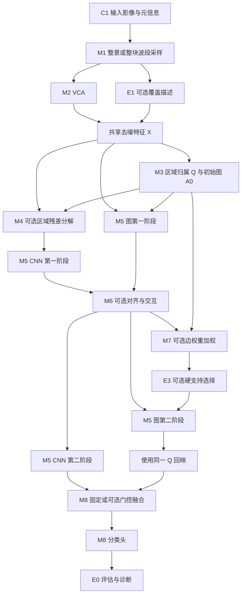

# E2E_VCA 模块化搭建、测试与消融实施计划

> **G3-V4通过（Issue #61）：**[开发分区训练接入与短闭环](reports/G3V4_开发分区训练接入与短闭环_20261102.md)完成CPU2/GPU2测试和真实两步GPU检查；训练统计/优化标签/图上下文隔离，45标签验证NLL选checkpoint。无完整预算精度结论。下一模块直接开展预登记1000/5000目标更新对照，不新增无关机制。

> **G3-V3冻结（Issue #60）：**[空间分层开发标签协议](reports/G3V3_空间分层开发协议冻结_20261102.md)通过2项测试与真实准备，5块devval覆盖九类，90训练+45验证共135标签。规则使用原train类别覆盖信息，明确oracle辅助；旧入口不兼容。下一模块实现仅devtrain归一化/图上下文与验证选模访问隔离，尚未训练或声称精度提升。

> **G3-V2覆盖核查（Issue #59）：**[九类标签覆盖及固定训练区留出审计](reports/G3V2_标签完整性与空间覆盖审计_20261102.md)确认第3类全图2783像素，原val/test均0；固定每五train块留一块仍缺第3类。工程2/2及真实计数审计通过，候选留出不满足九类覆盖。下一模块设计披露oracle类别覆盖信息的确定性空间分层协议，暂不训练。

> **G3-V1可行性（2026-11-02，Issue #58）：**[独立目标验证准备](reports/G3V1_独立目标验证协议可行性_20261102.md)工程测试2/2、旧协议回归4/4通过，但真实val区缺第3类，90训练+45验证九类方案准备失败，尚未冻结训练协议。保留失败，不从测试区补标签。下一模块评估训练区内空间留出，暂不开始预算调参训练。

> **训练复盘要求（2026-11-02）：**每次训练结束分析曲线、逐类/分支表现及模块实际执行情况，开展公平开关消融后再判定有效性；形成保留/修改/关闭/待验证决定。见[固定流程与当前证据台账](../docs/guides/post-training-review.md)。不能用工程通过替代精度收益，预登记多种子批次内不按测试改配置。

> **G3-P2完成（2026-11-02）：**[三种子复验结果与核验限制](reports/G3P2_三种子配对复验结果_20261102.md)：OA从头63.03±1.76%、全量微调62.89±4.74%，未证实稳定OA收益；AA改善且类别取舍明显。保留基线，下一模块建议训练/验证侧诊断与独立选模协议，不按当前测试调参。剪枝/量化继续冻结。下方为历史阶段记录。

> **G3-P2更新（2026-11-01）：**[三组新训练种子已预登记并启动串行复验](reports/G3P2_跨传感器三种子配对复验预登记_20261101.md)，协议回归4/4和真实预检通过；固定原支持集/划分/预算，尚无完成结论。本模块完成并审计后再推进新机制。

> **G3-P1更新（2026-11-01）：**[真实完整初筛已完成并审计通过](reports/G3P1_跨传感器完整初筛结果与逐类分析_20261101.md)：源10000、目标三组各1000更新；OA从头57.25%、仅头38.90%、全量微调68.79%。单种子、每类10标签，目标测试缺第3类；有额外源预训练成本，不修改默认配置。下一模块建议固定支持集做至少3个配对模型种子复验；剪枝继续冻结。下方“尚未运行”等为历史阶段状态。

> **E4a-2更新（Issue #53）：**独立G3训练入口已完成[CPU/GPU短闭环与真实预检](reports/E4a2_G3训练入口与预验收_20261031.md)。真实完整初筛尚未运行；下一任务按源10000/目标三组各1000更新启动，不按目标测试调参。剪枝保持冻结。

> **E4a执行更新（Issue #51）：**[PaviaU→Xuzhou G3协议已冻结并验收](reports/E4a1_跨传感器少样本协议冻结验收_20261031.md)：主预算10/类共90目标支持标签、目标验证0、空间隔离，不属于零样本或G2。尚未训练或计分；下一模块实现源预训练与固定预算目标适配入口，剪枝继续冻结。

> **当前执行更新（Issue #49）：**M1独立真实波段子集/元数据接口已有[工程验收](reports/M1_真实波段子集与元数据同步验收_20261031.md)，尚未接入分类训练。优先补E4a源/目标与标签预算协议、建立跨传感器基线；剪枝工具冻结，不推进剪枝精度训练。

> **统一训练监测补充（2026-10-31，Issue #37）：**按[监测搭建与训练接入计划](统一训练监测搭建与训练接入计划_20261031.md)分MON-0～4实施。先验收激活频率与权重只读采集，再接入梯度/实际更新、固定探针与消融；支撑三主线，不按低频或小权重自动剪枝。全部planned、默认关闭，未修改现有训练。

> **2026-10-31当前研究重心（用户确认，替代旧两主线定位）：**A区域—像素互补、B跨传感器光谱适配、C剪枝与量化；三条都以尽可能提升精度为首要目标，后续在预声明精度约束下尽可能加速。详见[三主线与论文用途](三主线研究重心与剪枝量化及论文用途_20261031.md)。E4a协议前移，C0-R冗余/低活性诊断先于裁剪，MiTA、剪枝及量化均为planned候选，不表示已实现或有效。

> 日期：2026-10-28  
> 开发主目录：`F:\E2E_VCA`  
> 目标：把已有模型和拟新增机制拆成可独立运行、测试、关闭、替换及组合的模块。  
> 本文只规划模型、数据协议与实验，不涉及训练环境安装和兼容问题。

> **最新执行约定：**所有代码运行、依赖安装和测试（包括合成、单元、回归、集成和真实数据实验）统一通过 `ssh rmvision` 在远程训练容器执行。Windows 仅承担编辑、文档和 Git 操作。首次连接核实宿主机/容器、工作目录和运行环境；复用仓库前检查未提交修改；验证前记录分支、commit 与待验证修改的同步状态。此约定替代本文较早的本地测试安排；过去已执行的本地测试仅作历史记录。

本文是[研究整合总计划](研究内容整合与详细搭建测试计划_2026-10-28.md)的模块化实施版本。下文标注“新增”的文件、接口和配置均为拟开发内容；本轮未修改模型实现或启动真实数据训练。

**2026-10-30候选登记（Issue #25）：**MiTA列入M6/E3候选；新论文的宽度冗余分析列为E0-R诊断与容量对照候选。两项状态均为`planned`，不改变模块交付顺序或当前默认配置。详见第10.1、16.1节和[论文评审](reports/MiTA与遥感宽度冗余论文评审及候选计划_20261030.md)。完整初筛已完成，当前优先核查冻结CNN/Graph/融合错误，再决定是否开启候选开发。

## 0. 已确认的执行方式：模块交付、版本冻结、容器验证

后续以 `F:\E2E_VCA` 现有项目为基础，以[研究内容整合与详细搭建测试计划](研究内容整合与详细搭建测试计划_2026-10-28.md)为主工作清单。本轮用户进一步明确：**每完成一个模块进行一次版本管理；需要真实数据集验证时，从 GitHub 拉取已提交版本到后续提供的容器中执行。**

执行分工：本地编写代码与维护文档/Git；GitHub 管理 Issue、提交、PR 与不可变版本引用；远程训练容器承担所有代码运行、依赖安装、合成单元/回归/集成检查及真实数据训练、消融和迁移验证。通过 `ssh rmvision` 直接连接，不运行桌面 bat。登录宿主机时先确认训练容器及进入方式；连接不可用时继续准备代码和配置，测试保持待执行，不在 Windows 上替代运行。

### 0.1 每个模块的固定交付循环

```text
从主工作清单提取一个模块 Issue
  → 固定接口、允许修改路径和验收条件
  → 本地独立分支开发
  → 同步当前修改到远程，核对分支、commit 和工作树
  → 在远程容器执行数值/梯度/关闭回归/合成集成测试
  → 提交代码、配置、测试、文档
  → 推送 GitHub 分支，建立 PR 和明确 commit SHA
  → 若需要真实数据：容器拉取该 SHA，验证并报告
  → 修复时提交新 SHA，重新验证受影响部分
  → 满足验收后合并并冻结模块版本
  → 开始依赖它的下一模块或组合实验
```

每个模块必须有独立的交付提交或 PR，不能等几个模块一起完成后再做一次混合提交。过程中允许多次小提交；模块验收时整理为可定位的完整版本。不依赖容器的模块可先完成验收；需要真实数据证明的研究任务在结果完成前保持开启。

### 0.2 版本约定

| 对象 | 约定 | 用途 |
|---|---|---|
| 模块开发分支 | `codex/issue-<编号>-<模块名>` | 隔离开发；编号实际创建后使用 |
| 开发交付版本 | 完整 commit SHA＋对应 PR | 合成通过、待容器验证时即可精确引用 |
| 已验收模块版本 | 建议 annotated tag：`module-m4-v0.1.0` 等 | 在可复用模块验收点冻结，标签不移动 |
| 容器运行版本 | checkout 的完整 SHA | 验证不得只写“main 最新版” |
| 数据验证报告 | 独立报告提交，关联 tested SHA、run_id 与 Issue | 结果追溯，不把训练产物混入代码提交 |
| 全项目里程碑 | 完成一组模块后另建 `v0.x.0` | 表达整体可用能力，区别于模块版本 |

模块标签只表示对应提交快照及其声明的验收范围，不表示单独发布一个 Python 包，也不代表整套研究已经验证。修复后增加补丁版本，不能移动旧标签。合并若产生新提交或解决冲突，最终版本上复跑必要的回归；若影响预测或协议，重新进行对应容器验证。

“代码交付”和“数据验证”分开记录：合成检查通过可以形成代码版本；真实精度、鲁棒性、机制有效性的结论必须有容器运行证据。实验 Issue 完成不要求正向提升，但要求协议、结果、失败和结论完整。

### 0.3 按主工作清单顺序交付的模块版本

沿用本文模块 ID，不重新命名现有研究模块。下表为建议执行顺序；每一行各自形成一个可追溯版本。

| 顺序 | 模块与主清单来源 | 本地交付内容 | 真实数据容器验收 | 版本标记示例 |
|---|---|---|---|---|
| 0 | 基线登记／P0 | 现有源码、未提交差异、测试、原始入口与来源清单 | 现有固定配置基线复跑；容器提供后执行 | `baseline-v0.1.0`，注明已验收范围 |
| 1 | C0 配置与记录／P0 | 模式校验、运行身份、模块开关、版本及配置保存 | 无需真实训练，后续运行复用 | `module-c0-v0.1.0` |
| 2 | C1 数据与划分／P0 | 登记、固定划分、空间分区、监督访问测试 | 核实三主数据集形状、标签、划分、统计与图访问边界 | `module-c1-v0.1.0` |
| 3 | M2 VCA／P0 | 封装既有实现、元数据与缓存回归 | 多种真实 B 前后向与输出检查，复用后续基线运行 | `module-m2-v0.1.0` |
| 4 | M3 区域图／P0 | Q/A、候选、正则与诊断契约 | 实际区域数、nnz、梯度和分区隔离检查 | `module-m3-v0.1.0` |
| 5 | M5 两阶段骨干／P0 | 统一普通/插件路径，保留当前宽度与阶段行为 | 与记录基线对齐，小规模学习检查 | `module-m5-v0.1.0` |
| 6 | M8 融合与分类／P0 | 固定融合、三头监督、可选 logits、保存恢复 | 与基线共用验证，检查损失、概率与类别维度 | `module-m8-v0.1.0` |
| 7 | E0 评价诊断／P0、测试章节 | 指标手算、边界/逐类/纠错、产物导出 | 同一基线预测核对统计和图表 | `module-e0-v0.1.0` |
| 8 | M6 交互／P1 | 复用现有交互，方向与强度开关、分块梯度 | 无/相加/门控/单向的指定诊断实验 | `module-m6-v0.1.0` |
| 9 | M7 重加权／P1 | graph/joint、归一化、支持与保存恢复 | 核心二因素、边权及分支证据 | `module-m7-v0.1.0` |
| 10 | M4 残差分工／P2 | 分解、容量对照、软/硬 Q、集成开关 | 原始/容量/X+R/仅R，边界与小类、多种子 | `module-m4-v0.1.0` |
| 11 | M1 观测采样／P3 | 真实 B 变化、元数据同步、固定扰动清单 | 完整/随机缺失/连续缺口/低密度性能曲线 | `module-m1-v0.1.0` |
| 12 | E1 覆盖度／P3 | 描述、调制、缺失回退、普通调制对照 | 同增强下二值/连续/打乱、与残差二因素 | `module-e1-v0.1.0` |
| 13 | E4a 迁移／P4 | 类别映射、共享头、支持集与家族留出协议 | 跨场景、固定预算适配及可成立的家族留出 | `module-e4a-v0.1.0` |

M2/M3/M5/M6/M7/M8 已有大量实现，交付目标是整理接口与证明回归，不是从头重写。E2 条件多尺度、E3 硬路由、E4b 测试时适配及开放集按主清单进入条件选做，各自沿用同样版本循环。

表中的完整精度消融属于研究验收，可以组织为关联实验 Issue；不要求每完成一个小封装都重新跑全部训练。基线链路的真实检查可在同一容器批次覆盖多个模块，但每个模块的提交、版本与证据仍独立关联。已有待验证模块的下游可以在冻结契约下继续开发，不将其数据结论当作已成立。

### 0.4 容器只拉取可追溯的 GitHub 代码

容器提供后再确认仓库访问方式、数据挂载、工作目录与可用资源。仓库凭据不写入配置、日志或 Git URL。真实数据和产物使用独立挂载目录，代码目录保持可核查。

建议采用每次运行独立 checkout。示意流程如下，其中具体 SHA、路径和运行命令由相应 Issue 的冻结清单给出：

```text
git clone <目标 GitHub 仓库> <该运行的代码目录>
git fetch origin <冻结版本引用>
git switch --detach <完整 commit SHA>
检查 HEAD 等于预期 SHA，工作树干净
使用仓库内的固定配置和验证入口运行
结果写到独立 artifacts/run_id，而非源码目录
登记命令、配置哈希、代码 SHA、数据/划分指纹与结果
```

已有容器 checkout 只做正常 fetch；有未提交变更时先保留和核实，不用自动 reset/clean 覆盖。不能以本地复制一个未提交 `.py` 文件修补容器后直接形成正式结果；修复先进入 GitHub 新提交，再拉取该版本复测。

若验证的是 PR 分支，记录实际拉取 SHA；若要对最终合并标签宣称已验证，应确认最终代码一致或按影响复测。代码在运行期间保持冻结，后续 fetch 不应改变当前实验 checkout。

### 0.5 容器验证按四级推进

| 级别 | 验证内容 | 作用 |
|---|---|---|
| V1 数据链路 | 文件、形状、波段元数据、标签计数、划分与读写 | 排除数据准备与协议错误 |
| V2 真实小规模 | 少量块或少量优化步骤、前后向、梯度、保存恢复 | 判断模块在真实输入上能运行并学习 |
| V3 固定完整预算 | 指定数据集、固定选模与训练预算 | 得到可比较的正式结果 |
| V4 消融与机制 | 多种子、容量/预算对照、边界/小类/鲁棒性与迁移 | 支持或否定研究假设 |

每个模块按任务需要选择级别。C0 等基础模块无需凭空增加真实精度实验；M4/E1 等研究模块必须经过相应 V3/V4 才能形成有效性结论。PaviaU、Xuzhou、HongHu 是首批候选，保持原主清单口径。

### 0.6 运行与交接记录

每项交付保存：模块 ID、主清单章节、Issue/PR、远程代码分支与 SHA、标签、修改范围、远程测试命令与结果、容器验证级别、是否待验证、run_id、配置与数据/划分哈希、选模依据、指标和失败记录。若修改尚未推送，先同步到独立的远程分支或工作树，记录补丁/源码哈希与 dirty 状态；不得拿旧 HEAD 的测试代替当前修改。正式实验仍优先使用已推送的冻结提交。

同一容器内并行任务使用独立代码与输出目录；真实训练与耗时实验按资源排程。评审者默认读取冻结代码和产物，修复由任务负责人提交新版本，避免多个智能体直接修改同一容器工作树。

首次需要容器而尚未提供时，准备好精确 SHA、验证配置、数据需求与执行命令清单；该状态记为“代码已交付，容器验证待执行”。不会通过本地真实训练替代用户指定的容器流程。

## 1. 总体方案：先有可测的积木，再组装研究模型

第一项新增机制建议选择**区域表示与像素残差分工**。真实波段子集与覆盖度建模作为第二项独立机制。当前已有的双向交互和边权重加权先独立评估；条件多尺度、硬连接选择与测试时适配按结果后续选择。

模块化不意味着同时打开所有模块。每个模块需要有：固定职责、稳定张量接口、显式配置、关闭或基线模式、最小测试样例、专属诊断和对应消融组。不能只在一个大 `forward` 中增加十几个互相依赖的布尔判断。

建议将模块分为三层：

| 层次 | 组成 | 作用 |
|---|---|---|
| 基础控制层 | C0 配置与记录、C1 数据与划分 | 保证所有实验可追溯、信息访问一致 |
| 主模型层 | M1 观测采样、M2 VCA、M3 区域图、M4 分解、M5 两阶段分支、M6 交互、M7 边权、M8 融合与分类 | 支持逐项搭建与结构消融 |
| 验证及扩展层 | E0 指标诊断、E1 覆盖度、E2 条件多尺度、E3 硬路由、E4 迁移/适配 | 验证主张，按证据深化 |

### 1.1 前向计算图



关闭 M4 时 CNN 接收原 X；关闭 M6 时保持两路中间特征；关闭 M7 时 A1=A0；关闭 E3 时使用 M7 的图。E1 第一版在 VCA 输出与共享去噪之间进行轻量调制，因而会间接影响后续 Q/A；通过固定 Q 的补充对照判断这一路径的作用。

E2 多尺度是对分支内部算子及图候选构建的可选替换，不在第一版基础图中展开。C0 负责组装配置，E0 负责读结果，不应参与模型预测。

### 1.2 当前实现与新增边界

| 模块 | 当前基础 | 计划工作 |
|---|---|---|
| M1 观测采样 | 当前 band-drop 只对训练标注像素置零 | 新增真实波段子集及元数据同步 |
| M2 VCA | 已实现任意通道、三种注意力及 anchor_valid | 复用；规范元数据与诊断输出 |
| M3 区域图 | 已实现 learned Q/A 和 static 路径 | 复用；增加统一输出与可控固定区域对照 |
| M4 残差分解 | 已有池化/回映函数 | 新增分解与分支输入投影 |
| M5 两阶段分支 | 已有 CNN 两块、图两层及图阶段接口 | 统一调度，保证新增机制在所有路径生效 |
| M6 中层交互 | 已实现对齐、加法/门控、方向选择 | 复用并做机制诊断 |
| M7 边重加权 | 已实现 graph/joint 两种模式 | 复用；与硬拓扑分开 |
| M8 融合与头 | 固定融合、三个数据集专属头 | 显式配置融合；新增可选 logits 与共享语义头 |
| E0 指标诊断 | 已有 OA/AA/Kappa 和交互导出 | 新增逐类、边界、误差组合与配对汇总 |
| E1/E2/E3 | 缺完整实现 | 独立新增，按顺序验证 |
| E4 迁移与适配 | 缺完整任务协议 | 独立训练/评估入口，后续接入 |

## 2. 所有模块共同遵守的接口规则

### 2.1 张量与数据对象

建议新增 `model/research_types.py`，用轻量结构明确输入输出。以下是接口草案，不代表必须采用某种具体类实现。

```text
Observation:
  spectral        [H,W,B]      # 不含坐标
  coordinates     [H,W,2]
  wavelengths     [B] or None
  wavelength_unit nm / normalized_index
  wavelength_quality measured / estimated / unknown
  fwhm            [B] or None
  band_ids        [B]          # 对应原始波段索引
  band_valid      [B]
  gsd             [2] or None
  metadata_valid  固定字段的有效性标记
  scene_id, sensor_family

GraphState:
  Q               sparse [N,M]
  A0              sparse [M,M]
  region_mass     [M]
  region_coords   [M,2]
  candidate_info  图候选的定义及边索引
  losses          可微分图正则
  diagnostics     不参与优化的统计

BackboneOutput:
  fused           [N,64]
  cnn             [N,64]
  graph           [N,64]
  auxiliary_losses
  diagnostics
```

N=H×W，M 为区域数。标签、训练掩码、验证掩码、测试掩码属于 `SupervisionBatch`，不放进模型可访问的 `Observation`。历史 static 标签引导构图在数据准备层单独标记，不能成为目标无标签默认路径。

### 2.2 关闭、初始化与梯度规则

1. 关闭一个研究模块时，其输出应回到明确定义的基线行为；基础 VCA 和图分支则使用替换基线，不做无意义的“全删”。
2. 新模块初始化不能改变原有主干与分类头的随机初始化。可复用当前交互模块的随机状态隔离方式。
3. 诊断中的均值、图像、分位数默认 detach；图正则和模型真正使用的特征保留梯度，两个字典分开。
4. 所有模式保存到 checkpoint 配置；加载后能够恢复实际结构。
5. 训练、验证、导出调用同一条模型组装路径，不能各写一套分支判断。
6. 全图 N×N 或稠密 N×M 只允许出现在小型测试例子中；正式运行使用局部稀疏映射。
7. “独立消融”指单独切换机制后从头训练比较；推理时关闭模块属于干预实验，二者分别报告。

## 3. C0：配置、组装与实验记录模块

**职责：**统一控制开关、构造模型、保存运行身份和统计参数。它不负责具体模型数学计算。

**拟新增文件：**`model/research_config.py`、`research_ablation_presets.py`、`run_research_ablation.py`。

### 搭建步骤

1. 复用现有 `InteractionConfig` 的校验方式，建立研究配置；现有交互字段保持含义一致。
2. 将“模式、结构宽度、训练损失、数据协议”分为独立配置组，避免同时改动。
3. 将模式转为模块实例；关闭模块使用旁路或不创建其可训练参数。
4. 在配置解析时拒绝非法组合，而不是训练一半再报错。
5. 保存 `resolved_config.json`、源码文件哈希、数据与划分哈希、参数总量和各模块新增量。
6. 调度器先生成实验清单，支持 dry-run、单组运行、失败记录和按运行 ID 恢复。

### 测试与消融要求

- 未知模式、维度不匹配、非法交互方向、错误预算立即报错。
- 改一个字段生成一个新的运行 ID；关闭模块不残留 trainable parameters。
- 基线与新增模块实例拥有相同的共有参数初始值。
- 保存、重建、严格加载后的结果一致。
- 同名运行不覆盖历史权重；配置变化时不能误当作已完成运行跳过。

**验收：**任何结果都能由“配置＋代码＋数据＋划分＋随机种子”重建；消融不用手改源码。

## 4. C1：数据、划分与监督模块

**职责：**准备可用观测、训练/验证/测试索引、类别映射及固定归一化统计。

**输入：**本地原始影像、标签、元信息登记、划分配置。  
**输出：**Observation、SupervisionBatch、协议清单。

**复用：**`loadData/data_read.py`、`loadData/split_data.py`。  
**拟新增：**`loadData/dataset_registry.py`、`loadData/spatial_split.py`、`loadData/protocols.py`。

### 搭建步骤

1. 首批登记 PaviaU、Xuzhou、HongHu；保留传感器家族与波长来源标记。
2. 保存随机像素划分供历史对照；新增空间块隔离协议供主要泛化验证。
3. 空间协议按分区独立准备输入、区域与图；不只替换损失掩码。
4. 训练区拟合归一化统计，冻结后应用；若采用整景目标无标签统计，另列适配协议。
5. 区分类别编号和类别语义；跨域任务使用预先确定的映射或固定预算支持集。
6. 将 split/model/augmentation/support seeds 分开保存。

### 必测用例

- 三集合交集为空；标签 0 不进入前景监督。
- 分区图不含跨区边，区域候选与种子池化不跨区。
- 更改测试标签不改变训练输入、图、归一化参数或训练梯度。
- 在严格隔离协议中，更改测试区影像不改变训练输入与训练阶段输出。
- 交换数据集加载顺序不改变已记录的划分。
- 类别缺失、支持样本不足、元信息缺失均有明确定义与记录。

**消融方式：**随机像素整图传导与空间隔离属于两套协议，分别汇总；不能通过只给新方法更宽松的数据访问取得优势。

## 5. M1：真实波段子集采样模块

**职责：**改变当前可见观测，保证波段与元数据对应。它不计算 VCA 或分类损失。

**拟新增文件：**`loadData/observation_sampling.py`。  
**接口：**`sample(observation, sampling_config, rng) -> observation_view, sampling_record`。

### 模式与关闭行为

| 模式 | 操作 | 作用 |
|---|---|---|
| `none` | 保留全部有效观测 | 基线 |
| `random_subset` | 随机保留固定比例波段 | 任意子集训练 |
| `contiguous_gap` | 按波长区间删除连续片段 | 连续缺口鲁棒性 |
| `uniform_stride` | 按原始索引等间隔采样 | 低采样密度 |
| `range_crop` | 保留实际存在的光谱子范围 | 覆盖范围变化 |

这些模式名称为拟新增配置。现有训练入口的 band-drop 保留为“训练像素置零”的历史对照，不能将其改名后当作真实子集。

### 搭建步骤

1. 仅对 spectral 维度选择 S，坐标保持完整。
2. 同步选择 wavelengths、FWHM、band_ids、有效性标记。
3. 每景或每块共享同一组 S，覆盖所有输入像素。
4. 原波段归一化统计按 S 取子集，不在每次增强后重新拟合。
5. 训练子集与最终评估子集分别生成，测试扰动固定保存。

### 测试与消融

- 全保留与原输入一致；单波段有效；空子集报错。
- 数组长度、索引、单位一致；不会把坐标当光谱删除。
- 同一 seed 得到同一 S；训练和测试子集列表互不复用生成状态。
- 对比无增强、旧置零、真实子集训练；以相同冻结测试子集评估。
- 缺失水平先取保留 100%、75%、50%、25%，再按验证需要扩展。

**验收：**模型实际接收到不同 B，而不是保持 B 不变只填零。

## 6. M2：VCA 光谱适配模块

**职责：**将 B 波段观测映射为 K 个潜在通道，返回观测覆盖诊断。

**现有文件：**[variable_channel_adapter.py](F:/E2E_VCA/model/variable_channel_adapter.py)。  
**输入/输出：**`[H,W,B] + metadata[B] -> [H,W,K] + adapter_info`。

### 搭建步骤

1. 保留 wavelength/index/uniform 三模式作为适配基线。
2. 第一轮固定 K=64、embed_dim=32，后续 K 的研究另列消融。
3. 使用现有 attention 返回接口导出 anchors、attention、anchor_valid。
4. 明确 nm 与归一化索引，缺失波长不静默冒充真实物理波长。
5. 坏波段在进入注意力前过滤，或由明确 mask 排除。
6. eval 缓存必须随输入元信息和模型参数变化失效；适配 VCA 参数时禁用 detach 缓存。

### 测试与消融

- 12/20/103 等不同波段数映射为相同 K。
- 同时置换波段与对应波长，wavelength 模式结果接近不变；index 模式不要求此性质。
- 波长长度不匹配立即报错；无覆盖锚点输出有限。
- 缓存开关输出一致；改变波段子集不能复用错误注意力。
- 在相同主干下比较 wavelength/index/uniform，单独报告 K 和宽度变化。

**验收：**复用已有功能，避免把已存在的波长编码当作本轮新增贡献。

## 7. M3：区域归属与初始图模块

**职责：**产生 Q、A0、区域位置及图正则；不参与交互和后续边剪枝。

**现有文件：**[learnable_superpixel_graph.py](F:/E2E_VCA/model/learnable_superpixel_graph.py)。  
**接口：**`build_graph(X[H,W,64], scale) -> GraphState`。

### 搭建步骤

1. 先封装现有 learned 局部稀疏 Q/A 输出，保持原数学行为。
2. 默认像素归属半径 1、区域图半径 1；保存网格形状、实际 M、nnz(Q)、nnz(A0)。
3. 增加无标签固定网格或无标签区域作为可控对照；它与历史标签引导 static 图分开命名。
4. 允许注入手工 GraphState，用于其他模块的独立测试。
5. 将图正则与 detach 诊断分开，避免损失被意外截断。

### 测试与消融

- Q 非负且有效行和约为 1；A0 非负、行归一化。
- 默认 Q 每行至多 9 个候选，边界索引不越界。
- 空区域处理有限，分配网络和图评分网络收到非零梯度。
- 固定 Q/固定 A、固定 Q/学习 A、学习 Q/学习 A 按需分组，不能把三种变化合并归因。
- 分类监督影响 Q 时称任务驱动区域，不声称区域已具有真实语义。

**验收：**其他模块拿到 GraphState 即可独立运行，不依赖内部构图细节。

## 8. M4：区域表示与残差分解模块——第一项新增骨干机制

**职责：**显式保留区域聚合压缩的像素偏离信息，生成 CNN 输入。

**拟新增文件：**`model/region_residual_decomposition.py`。  
**复用函数：**`pool_regions`、`broadcast_regions`。

\[
Z=D_Q^{-1}Q^\top X,\quad X_r=QZ,\quad R=X-X_r,\quad X_c=\phi([X,R]).
\]

**接口：**`decompose(X[N,64], Q) -> X_c[N,64], Z[M,64], diagnostics`。

### 模式

| 模式 | CNN 接收 | 目的 |
|---|---|---|
| `none` | X | 原始基线 |
| `capacity_control` | 相近参数量的 X 分支内变换 | 容量对照 |
| `x_residual` | 投影后的 [X,R] | 核心模型 |
| `residual_only` | R 或明确的同宽投影 | 原语义必要性 |
| `x_region` | 投影后的 [X,Xr] | 区域提示与残差提示区别 |

### 搭建步骤

1. 先只完成无参数聚合、回映、相减，用手工数据验证。
2. 再增加 `[X,R]` 的 128→64 投影；可初始化为 `[I,0]`。
3. 图分支继续接收原 X 的区域表示；同一前向不重复生成 Q。
4. 输出用于训练的 Xc 与 detach 诊断，按需导出 Xr/R，默认不保存全分辨率中间数组。
5. 与固定融合、关闭交互/边更新的基线先组合，不同步增加其他新机制。

### 单元测试

| 用例 | 通过条件 |
|---|---|
| 硬 Q 与已知区域 | 均值和回映等于手算值 |
| 恒等重建 | Xr+R≈X |
| 硬区域残差均值 | 每个有效区域内约为零 |
| 软 Q | 输出/梯度正确；不强求聚合残差为零 |
| 空区域 | 无 NaN，空区域表示符合约定 |
| 稀疏/稠密小例子 | 输出与梯度接近 |
| 旁路模式 | Xc=X，结果回到基线 |
| 可学习 Q | 对分配 logits 的梯度保留 |

### 正式消融与机制指标

先做原始、容量对照、X+R、仅 R 四组；再考虑 X+Xr。固定同一 VCA、图方式、辅助损失和训练预算。

主看边界 macro-F1、小类别召回、区域内部错误率、残差对噪声与条带的响应。R2 若仅超过原始模型、未超过容量对照，不能把收益归因于区域残差。

不添加恒为零的分解重建损失；软分配残差不直接命名为严格高频。互补性需要融合纠错证据，不以两个分支差异更大作为充分条件。

## 9. M5：两阶段 CNN/GCN 骨干模块

**职责：**为交互、边更新提供稳定阶段接口，统一普通路径与交互路径。

**现有文件：**[VCASAHGCN.py](F:/E2E_VCA/model/VCASAHGCN.py)。

```text
cnn_stage1(Xc[H,W,64])       -> C1[N,128]
graph_stage1(Z[M,64], A0)   -> G1[M,128]
cnn_stage2(C1[N,128])       -> C2[N,64]
graph_stage2(G1[M,128], A1) -> G2[M,64]
```

### 搭建步骤

1. 先复用现有 CNN ModuleList 与图 `forward_stage1/2`，不改宽度与卷积核。
2. 统一执行顺序：生成 Xc/Z→第一阶段→可选交互→可选图更新→第二阶段。
3. M4 在统一调度之前生效，避免当前普通/interactive 两条路径中只有一条接入残差。
4. 原模块参数名尽量保留；若重构名称，提供显式权重迁移并测试。
5. 不把 E0 的诊断分类器嵌入主 forward 改变训练目标。

### 测试与消融

- 全部新模块关闭时，统一路径与当前原路径输出、梯度接近。
- M4 开/关×M6 开/关四组合均验证残差实际改变 CNN 输入。
- 多数据集、多 B、静态/可学习图运行一致。
- 共享参数量、算子深度与训练损失无意外改变。
- 后续多轮交互必须配同深度无跨分支消息对照，第一版只一轮。

**验收：**网络只有一套可信的阶段调度逻辑，各插件可以独立插拔。

## 10. M6：对齐与选择性交互模块——复用现有实现

2026-10-29 工程验收已完成：统一对齐交换入口、109项回归、六模式各两步GPU闭环及冻结预测核查，见[M6报告](reports/M6_对齐与选择性交互验收_20261029.md)。下文完整预算消融与机制验收仍待独立实验，不能以两步检查替代。

**职责：**将不同粒度特征对齐，再进行可选残差交换；不负责更改图支持。

**现有文件：**[region_pixel_alignment.py](F:/E2E_VCA/model/region_pixel_alignment.py)、[cross_branch_interaction.py](F:/E2E_VCA/model/cross_branch_interaction.py)。

**接口：**`interact(C1, G1, Q) -> C1_updated, G1_updated, diagnostics`。

### 搭建步骤

1. 先复用 region/global 对齐、none/add/gated 模式和单/双向开关。
2. 两方向都使用同一交互前快照，保持现有同时更新语义。
3. 默认残差强度 0.1、门控隐藏宽度 32；第一轮固定。
4. 关闭为恒等映射；方向关闭时不计算无用消息。
5. 同一接口既可接原 X 提取的 C1，也可接 M4 提取的 C1。

### 测试与消融

- none 或强度 0：两路特征不变。
- 单向模式：目标更新、来源保持不变。
- 分块与不分块输出/梯度接近；稀疏 Q 梯度保留。
- 原始、直接相加、门控、两个单向、global 对齐分别训练。
- region/global 只改变跨路消息，图分支自身仍使用 Q；不能称 global 为完全取消区域。
- 分支前后错误必须用可比较诊断读出或受控干预获得，不能从后验预测倒推。

**验收：**门控优于普通交换或具有明确的边界/噪声稳定收益，才进入最终候选。当前标量门不等于逐通道门，也不是校准可靠度。

### 10.1 MiTA候选原型：一个独立后端开关

来源为[MiTA v6](https://arxiv.org/abs/2602.01219v6)。以下全为待开发，不是当前`interaction_mode`已支持的值。**保留M6/E3候选位置，不把MiTA提前变成必做主线。**

拟议`interaction_backend=aligned|mita`，默认`aligned`；保持原`none/add/gated`、方向和强度参数。原型拟新增`model/mita_region_message.py`及独立测试，由一个写入负责人串行接入配置、骨干、checkpoint，先约定接口再实施。

1. 冻结C1/G1/Q及当前块边界；用Q池化CNN得到区域token，和G1形成跨路query/KV。landmark来自当前块的目标查询，top-k仅访问当前块来源KV。区域坐标/有效质量要显式处理，不能把不规则区域强当作规则图像网格。
2. 模块返回像素侧与区域侧的同形消息，接回原有残差/门控；两方向读取交互前快照。稠密对照也采用相同池化粒度和投影，避免将粒度或容量变化归给MiTA。
3. 第一版只做s=1，单列m/k与landmark定义；小于预算的候选池使用显式截断与mask规则，不能用重复填充偷偷改变softmax质量。共享压缩KV与路由KV拼接后用共同softmax语义，不能用无说明的两路结果平均冒充原方法。
4. 原型称MiTA-inspired跨分支适配，不称复现原论文自注意力模型。不得顺手加DWC、蒸馏、多轮交互、硬图剪枝或VCA修改。

| 待办 | 独立验收内容 |
| --- | --- |
| [ ] 接口与配置 | 先声明后端、m/k/s、mask/梯度规则和checkpoint元数据；关闭时不构造额外模块，原checkpoint可恢复 |
| [ ] 数值/梯度 | 小张量密集参考，公共softmax输出/梯度，landmark/Q及投影梯度，top-k离散索引的梯度限制；并列tie-break规则 |
| [ ] 边界 | 空/单区域、无效质量、m/k大于可用数、多波段、多任务头、分块一致、无跨分区KV；none与强度0恒等 |
| [ ] GPU最小闭环 | 证明候选被调用、有限梯度、损失可下降、保存恢复一致；一次独立提交/验收后停止 |
| [ ] 对照训练 | 原后端、参数匹配普通变换、同粒度dense attention、compress-only、route-only、MiTA组合；固定外层门控，以主效应为先 |
| [ ] 研究结论 | 同划分、共有参数初始化校验、同更新/调参预算、至少三个配对种子；报逐类/分支/鲁棒性与实际总成本 |

进入条件：现有冻结分支诊断已完成，有理由检验信息选择/消息容量；退出条件：同容量或dense对照已解释收益，或区域规模下无精度/成本实际价值。当前PaviaU单种子无OA提升，不自动构成引入MiTA的正证据。

## 11. M7：候选边重加权模块——复用现有实现

**职责：**在 A0 的既定候选上改变传播强度；不新增远程边，不声称硬剪枝。

**现有文件：**[graph_edge_update.py](F:/E2E_VCA/model/graph_edge_update.py)。

**接口：**`reweight(G1_updated, A0, pooled_C1=None) -> A1, diagnostics`。

### 模式与测试

| 模式 | 输入关系特征 | 消融含义 |
|---|---|---|
| `none` | 不使用 | A1=A0 |
| `graph` | 图特征 | 图内关系更新 |
| `joint` | 图特征＋CNN 区域聚合 | 关系层跨分支信息 |

测试支持集合不越界、行归一化、孤立点自环、有限梯度、前后边统计和保存恢复。static 非归一化图额外比较“仅行归一化”对照。

### 两套二因素设计

**直接交换×图内更新：**none/none、gated/none、none/graph、gated/graph。四组干净地区分直接交换和图内重加权。

**直接交换×联合关系更新：**none/none、gated/none、none/joint、gated/joint。用于检验直接特征交换与关系层交换，但 none/joint 已有跨分支信息，不能叫“完全无交互”。

**验收：**学习边权比只归一化、仅图特征更新或相近容量替代有独立价值。诊断时记录边权变化，不能只依据最终 OA 判断“图更合理”。

## 12. M8：融合、分类头与损失模块

**职责：**将同维两路表示融合并计算任务输出；损失定义独立于结构开关。

**接口：**`fuse_and_predict(C2[N,64], QG2[N,64], task_id) -> logits/probabilities`。

### 搭建步骤

1. 第一轮保持 `F=0.8*C2+0.2*QG2`，系数进入显式配置。
2. 三个分类头保留，新增可选 logits 输出，避免破坏旧概率调用。
3. 将融合损失、两分支辅助损失、图正则分别命名记录。
4. 可选位置门控融合单独实现为 `model/branch_fusion.py`，关闭时固定融合。
5. 共享语义头只在已建立类别映射的迁移任务使用；各数据集独立头仍服务原分类任务。

### 测试与消融

- 三路输出形状、概率和为 1、logits→softmax 对应正确。
- α=1/0 分别得到 CNN/图特征；该推理检查不替代单分支独立训练结果。
- 无训练标签位置不贡献监督；辅助权重为零时其损失梯度消失。
- 不改变现有概率损失公式作为模块化重构的隐含副作用；如统一为 logits CE，所有比较组同步切换并重跑基线。
- 原始固定融合、仅换门控融合、仅加分解、分解加门控构成完整四组。

**验收：**新分工的收益不依赖同时更换融合、损失与分类头。任何新损失都需独立开关和对应消融。

## 13. E0：评估、诊断与干预模块

实施拆分：E0a 先做冻结预测的整体/逐类指标、四邻域边界、分支纠错、稀疏图摘要和独立导出；E0b 再做敏感度/遮挡/区域替换/删边、细结构定义、成本与配对统计。2026-10-29 容器不可用期间经用户授权实现 E0a 候选，恢复后按 M8→E0a 完成远程验收，具体范围与限制见各模块报告；E0b 仍单独实施，不把 E0a 验收扩展为全部机制证据。

**职责：**冻结模型后测性能、机制与成本；不读取测试标签反向修改模型配置。

**拟新增：**`evaluation/classification_metrics.py`、`evaluation/region_diagnostics.py`、`evaluation/interventions.py`、`export_research_diagnostics.py`。

### 指标分层

| 层级 | 指标 | 回答的问题 |
|---|---|---|
| 整体 | OA、AA、Kappa、macro-F1 | 总体与类别平衡表现 |
| 类别 | 逐类 precision/recall/F1、混淆矩阵 | 哪些类别改善或受损 |
| 空间 | 边界带、内部、小目标、细窄结构 | 区域分工是否保留细节 |
| 双分支 | 两路正确/错误四组合、融合纠错率 | 是否存在可利用互补 |
| 观测 | 不同波段保留率、覆盖缺口与元信息扰动 | 鲁棒性是否与机制一致 |
| 关系 | 出度、边权变化、连通性、删边干预 | 传播关系是否有用 |
| 成本 | 参数、训练步耗时、每景推理、峰值显存 | 收益与实际代价 |

### 具体测试

1. 用手工混淆矩阵校验指标；空类别/空边界集合记 N/A，说明宏平均参与类别。
2. 最终测试标签生成的边界仅用于冻结后的诊断；四邻域双方有标注且异类才判为边界。
3. 1/2/3 像素边界带分别报告；不把未标注位置当背景参与统计。
4. 在小块上做梯度敏感度、局部遮挡、区域替换，避免全图像素两两雅可比。
5. 推理关闭残差/门控、删除重要边与随机边，作为干预结果，另与重新训练的消融结果区分。
6. 配对比较按场景、划分或完整重复统计，不能把大量相邻像素当独立样本。

**验收：**每个论文主张至少对应一个直接对照和一个机制诊断；不以 t-SNE 或热力图代替证据。

## 14. E1：观测覆盖度模块——第二项独立新增机制

**依赖：**M1、M2；不依赖 M4/M6/M7。  
**拟新增：**`model/observation_coverage.py`。

**接口：**`describe(metadata, anchors) -> coverage[K,q]`；可选 `modulate(latent, coverage) -> latent_updated`。

### 分两步搭建

先做无参数描述：最近有效波段距离、窗口内波段数、局部间隔和元信息有效标记。再做轻量调制，使用 K 维或 K×q 描述生成通道缩放与偏移，从近恒等初始化开始。

第一版在 VCA 输出上调制，后续去噪和构图照常执行。覆盖描述是每景观测信息，不能称为逐像素噪声真值；核尺度不能冒充真实 FWHM。

### 测试与消融

- 无参数描述在手工波长例子上正确，缺失/完全无覆盖情况有限。
- 关闭调制返回原 latent；参数梯度正常；缺失元信息有显式回退。
- 对比现有二值 anchor_valid、连续覆盖描述、相近参数量普通调制、打乱描述。
- 所有组使用相同真实子集增强，避免把增强收益归因于覆盖度。
- 在新子集、连续缺口、完整输入三种情况下评估。

### 与 M4 的组合

在相同真实子集训练下做四组：无残差/无覆盖、残差/无覆盖、无残差/覆盖、残差/覆盖。固定训练预算，计算配对指标交互效应。只有两项各自有效且组合有实际价值，才把组合视为候选最终模型。

## 15. E2：条件多尺度模块——通过前述验证后再选

**拟新增：**`model/observation_condition_encoder.py`、`model/conditional_multiscale.py`。

### 分成三个可独立测的子模块

| 子模块 | 输入→输出 | 基线 |
|---|---|---|
| 条件编码器 | 波长集合、GSD、缺失标记→e[32] | 不使用条件 |
| 多尺度候选器 | X→多个等宽 CNN 输出/多范围区域图 | 原固定卷积与半径 |
| 尺度选择器 | 内容摘要与 e→尺度权重 | 固定平均或仅内容 |

先每景一组权重；CNN 候选可从 dilation=1/2/3 开始；图候选保持同一 Q，以半径 1/2 比较，消息变换尽量共享。多范围候选由 M3 的候选构建扩展提供，M7 不能生成候选外的边。

测试权重归一化、单候选退化为普通算子、缺失 GSD、条件置换与保存恢复。消融包括固定算子、多尺度平均、仅内容、仅条件、内容＋光谱条件、再加 GSD；仅 CNN/仅图尺度选择分别比较。

**进入条件：**元信息可信且空间尺度确实是主要误差来源。**退出条件：**正确条件在留出条件下不优于仅内容，或权重主要记住数据集身份。

## 16. E3：硬支持选择与远程补边模块——与 M7 分开

**拟新增：**`model/budgeted_graph_router.py`、可选 `model/region_neighbor_search.py`。

**接口：**`route(A_weighted, candidates, region_features, budget) -> A_sparse, routing_info`。

### 搭建顺序

1. 先只在现有候选内实现 top-k/预算选择，验证输出实际减少 nnz。
2. 掩码作用于完整混合图，再行归一化，避免 A0 残差项恢复被删除边。
3. 明确预算含不含自环、是否补双向边、最少局部连接。
4. 记录离散选择的梯度规则；未选边没有普通 top-k 路径梯度，若用松弛或直通估计则单独测试。
5. 候选内机制有效后，才增加少量区域级远程候选；搜索、去重、评分与稀疏构建全部计时。

### 测试与消融

- 每节点边数符合预算；零值条目实际删除；无孤立错误、非法索引或 NaN。
- 同预算随机边、相似度边、仅图路由、联合路由、固定最终图重训。
- 远程边需比较同数量随机远程候选，尽量匹配度数/距离。
- 不把分块计算全对全相似度宣称为线性搜索。
- 关闭 E3 回到 M7 图；关闭 M7、只开 E3 也能运行，以便区分权重与支持变化。

**验收：**性能、实际支持变化及端到端成本三项分别报告。参数少、边少不自动代表更快。

### 16.1 MiTA与宽度冗余的候选任务边界

E3的landmark共享候选试验须独立于10.1节M6消息试验：先完成普通预算top-k，再比较同预算随机/相似度/landmark候选，最后才考虑远程候选。MiTA会构造共享压缩专家和路由KV；仅改变KV检索不等于删A中的边。若声称硬支持变化，仍必须实际移除零值条目、报告nnz与出度并计入完整搜索成本。

宽度冗余参考[arXiv:2601.22841v2](https://arxiv.org/abs/2601.22841v2)，暂列E0-R诊断与M5/M6容量对照，不新增必做模块。拟议诊断脚本`evaluation/representation_redundancy.py`与缩宽策略接口均未实现，不能把建议文件当作可运行命令。

- [ ] E0-R：冻结checkpoint，按同一Q将CNN/Graph对齐到可比较的区域支持，统计相关、PCA和有效维度；分支比较使用相同样本与采样上限。只在训练/验证开发规则，不按测试标签选择通道。
- [ ] 诊断测试：已知秩/重复通道/常数通道/空集合的手算fixture，尺度及样本数敏感性；特征提取前后权重和输入hash不变，输出在checkout外。
- [ ] 容量接口：内部宽度与外层128/64维契约、归一化、图投影、交互投影和任务头逐项列清。不能把VCA的K或真实观测B变小叫作同一种缩宽。
- [ ] 缩宽对照：比例1.0/0.75/0.5先预声明；首段/末段/训练或验证确定的固定随机索引分别比较。post-hoc固定头、重新拟合头、从头训练窄模型分别验收；训练头时计入额外训练预算。
- [ ] 成本与接受条件：同时报告绝对指标/保持率与真实时间/显存/参数，保留下降结果；没有本项目证据前不启动多宽度联合训练，也不套用论文的1%FLOPs结果。

以上是长期候选待办，工程实现、真实数据结论和是否进入最终模型分别验收；每个实施Issue独立分支、唯一写入负责人，公共接口串行修改，完成后停止评审。

## 17. E4：跨域任务与测试时适配模块

这部分属于任务执行模块，不应与一个骨干开关绑定。

### E4a 迁移任务

新增 `train_cross_sensor.py`，接入 C1 的类别映射、家族留出、支持集与共享语义头。分别评估：已见数据集联合学习、同家族跨场景、整个传感器家族留出、固定标签预算少样本迁移。

测试目标域标签不参与源域训练、类别映射、选模和阈值选择。WHU-Hi 各场景间留出首先称跨场景；家族留出时同家族全部场景不得进入源域。

### E4b 测试时适配

新增 `evaluate_tta.py`，比较冻结、仅统计更新、仿射参数更新、小 Adapter。每景恢复与持续更新分开；在线任务先预测计分再更新。只允许白名单参数变化，目标标签不进入更新函数。

### E4c 开放集

闭集稳定后新增 `evaluation/open_set.py`。先用原型距离、最大概率、energy 等简单评分建立基线；energy 使用 M8 的原始 logits。0 号未标注不等于未知类，阈值由源域验证或独立开发集确定。

解混、物理生成与配准多模态仍是独立后续管线，参见总计划，不插入第一轮分类骨干消融。

## 18. 统一训练、测试与消融流程

### 18.1 每个模块必须走完的五道检查

| 检查 | 做什么 | 何时进入下一步 |
|---|---|---|
| T1 独立数值 | 小型手工输入、极端情况、稀疏/稠密对应 | 数值与梯度符合定义 |
| T2 基线回归 | 关闭模块、恒等初始化、保存恢复 | 原行为可恢复，共有参数未意外变化 |
| T3 最小集成 | 6×7 或类似小影像，多 B、多头、前后向 | 全链路有限，模块被实际调用 |
| T4 学习能力 | 小训练块拟合、100—200 步初筛 | 损失下降，目标参数收到梯度 |
| T5 研究实验 | 同容量、同预算、多种子、空间/迁移协议 | 支持或否定预设假设 |

模块功能测试不规定它必须提升精度；T5 负责判断研究价值。某模块在 T5 被否定，可以保留为有用的负结果和对照。

### 18.2 先验基线

Baseline B0：原 VCA、learned Q/A、原双分支、固定融合、原有分类与图正则，关闭 M4/M6/M7/E1/E2/E3。所有方法在同一协议下重新训练。

首批任务用 PaviaU、Xuzhou、HongHu；K=64，embed_dim=32。先固定超参数与三头监督，不同时研究归一化、宽度、损失和融合。

当前主入口存在 `epochs+1` 循环及随机域采样，训练预算以实际优化步数、各域采样次数为准。新调度建议统一记录 global_step；若改变旧循环口径，全部比较组同步重跑。

### 18.3 独立模块实验表

| 实验组 | 与 B0 唯一主要差异 | 回答的问题 |
|---|---|---|
| Bcap | 普通相近容量变换 | 参数增加能否解释收益 |
| R | M4 残差分工 | 信息分工是否有效 |
| I | M6 门控交互 | 中层消息是否有效 |
| Wg | M7 仅图边权 | 图内重加权是否有效 |
| Wj | M7 联合边权 | CNN 信息进入关系是否有价值 |
| O | M1 真实子集训练 | 增强本身是否有效 |
| C | M1＋E1 | 覆盖描述是否超出增强收益 |
| F | M8 可选门控融合 | 末端融合本身的收益 |

R、I、Wg/Wj、F 首轮均不额外加入观测增强；O/C 在相同冻结扰动集上评估。结构路线与观测路线的训练条件清楚分开。

### 18.4 只做有必要的组合

| 组合 | 最小组别 | 说明 |
|---|---|---|
| 残差×直接交互 | B0、R、I、R+I | 看交互是否破坏分工 |
| 直接交互×图内重加权 | B0、I、Wg、I+Wg | 区分两项机制 |
| 残差×门控融合 | B0、R、F、R+F | 防止融合变化掩盖分解贡献 |
| 残差×覆盖调制 | O、O+R、O+E1、O+R+E1 | 全部使用相同真实子集增强 |
| 权重×硬支持 | B0、W、E3、W+E3 | 后续区分 reweight 与 pruning |

对越大越好的指标 S，报告 `S11-S10-S01+S00` 及配对重复的不确定性。不要将所有模块的 2^n 组合全部运行。

### 18.5 每组结果需要保存

配置、代码哈希、数据/划分哈希、模型/支持集/增强种子、实际训练步数、验证选模依据、权重与结构侧边文件、三路预测、逐类/边界指标、模块诊断、参数与端到端成本。

最终至少 3 个配对重复，关键结论按波动增加至 5 次。先依据验证集筛选，冻结后评估测试；测试下降和失败种子完整保留。

## 19. 实际搭建顺序与阶段交付

| 批次 | 建什么 | 暂时不组合什么 | 交付与完成条件 |
|---|---|---|---|
| A | C0、C1、E0 基础；封装 M2/M3/M5/M8 | 所有新研究机制 | 原基线回归、固定协议、指标正确 |
| B | M4 | 交互、边权、门控融合 | R0/容量/R/仅残差四组与边界诊断 |
| C | 复用 M6/M7 | 条件多尺度、硬路由 | 原有模块独立消融及必要二因素组合 |
| D | M1 | 覆盖调制 | 真实变长观测、固定缺波段测试集 |
| E | E1 | 多尺度、硬拓扑 | 相同增强下的覆盖增益与残差组合 |
| F | E4a | TTA/开放集 | 空间隔离、支持集或家族留出证据 |
| G | E2/E3/E4b 三选一 | 其他复杂扩展 | 针对主要失效因素深化 |

若主要目标立即锁定跨传感器，批次 D/F 的数据接口与类别协议前移，与批次 A 一起建立。模块化顺序可以调整，接口和消融边界保持一致。

按开发与基本验证估计：A 约 3—5 个工作日；B 约 3—5 日；C 约 2—4 日；D 约 2—4 日；E 约 3—5 日；F 的工程约 1—2 周，取决于类别映射与数据条件。完整实验时间需以实际稳定步骤和验证耗时估算，不计入这些开发人日，也不承诺训练总工期。

## 20. 第一轮配置草案与完成标准

以下是**拟新增的配置结构**，不是当前训练入口已支持的命令：

```yaml
protocol:
  split: spatial_disjoint
  normalization_fit: train_region
  graph_scope: partition
observation:
  sampling: none
adapter:
  mode: wavelength
  latent_channels: 64
  embed_dim: 32
graph:
  mode: learned
  assignment_radius: 1
  candidate_radius: 1
decomposition:
  mode: none
interaction:
  mode: none
  direction: both
  strength: 0.1
edge_update:
  mode: none
coverage:
  mode: none
multiscale:
  mode: none
hard_routing:
  mode: none
fusion:
  mode: fixed
  cnn_weight: 0.8
heads:
  mode: dataset_specific
loss:
  fused_weight: 1.0
  cnn_weight: 1.0
  graph_weight: 1.0
  graph_regularizers: unchanged_from_baseline
```

R 实验只改 `decomposition.mode=x_residual`；O 实验只改观测采样及对应训练视图；C 在 O 上只改 coverage。复杂模式使用有名称的预设展开，最终保存所有解析后的数值，不能把 `unchanged_from_baseline` 这样的占位描述留在正式运行配置中。

第一轮完成标准：

- [ ] 关闭新模块能够恢复原基线，各开关可保存和恢复。
- [ ] M4 不依赖 M6/M7，M6/M7 不依赖 M4，E1 不依赖 M4。
- [ ] 模型基础路径与交互路径不会遗漏已开启的模块。
- [ ] 影像、元数据、监督与评价各有清楚访问边界。
- [ ] 真实子集输入改变 B，元数据逐项同步。
- [ ] 单元、回归、合成集成、小块学习四层验证通过。
- [ ] 原始与容量基线、关键单模块、必要二因素组合均有预先确定的配置。
- [ ] 正式结果有空间分层、多种子、成本和失败案例。
- [ ] 最终模型只保留具有独立证据或必要协同证据的机制。

## 附录：既有基础测试与文档关系

上一轮已实际执行根目录现有 18 项回归测试和可运行副本的合成冒烟测试，均通过。本轮仅核对当前接口并编写模块化计划，未重新声称执行新增模块测试。

现有回归入口为 `python -m unittest discover -s tests -p "test_interaction_modules.py" -v`。后续新增测试建议按责任拆为数据协议、观测采样、区域分解、组装回归与迁移协议测试；通过后再扩展正式精度实验。

研究背景、数据规模、历史实验差异及独立解混/物理生成路线，详见[总计划](研究内容整合与详细搭建测试计划_2026-10-28.md)。本文集中回答每个模块如何搭建、如何独立测、如何做消融，以及如何按证据集成。


