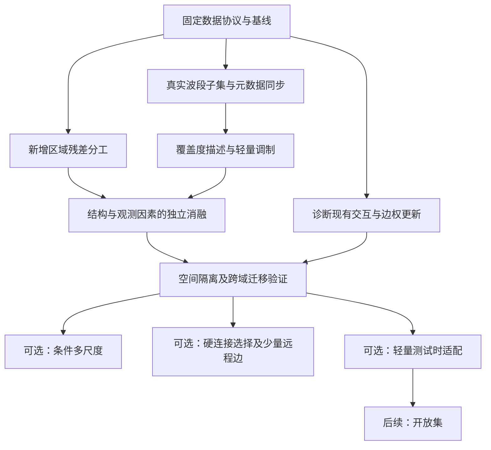

# 基于 E2E_VCA 的研究内容整合与详细搭建、测试计划

> **E4a-2更新（Issue #53）：**独立G3训练入口已完成[CPU/GPU短闭环与真实预检](reports/E4a2_G3训练入口与预验收_20261031.md)。真实完整初筛尚未运行；下一任务按源10000/目标三组各1000更新启动，不按目标测试调参。剪枝保持冻结。

> **E4a执行更新（Issue #51）：**[PaviaU→Xuzhou G3协议已冻结并验收](reports/E4a1_跨传感器少样本协议冻结验收_20261031.md)：主预算10/类共90目标支持标签、目标验证0、空间隔离，不属于零样本或G2。尚未训练或计分；下一模块实现源预训练与固定预算目标适配入口，剪枝继续冻结。

> **当前执行更新（Issue #49）：**M1独立真实波段子集/元数据接口已有[工程验收](reports/M1_真实波段子集与元数据同步验收_20261031.md)，尚未接入分类训练。优先补E4a源/目标与标签预算协议、建立跨传感器基线；剪枝工具冻结，不推进剪枝精度训练。

> **统一训练监测补充（2026-10-31，Issue #37）：**按[监测搭建与训练接入计划](统一训练监测搭建与训练接入计划_20261031.md)分MON-0～4实施。先验收激活频率与权重只读采集，再接入梯度/实际更新、固定探针与消融；支撑三主线，不按低频或小权重自动剪枝。全部planned、默认关闭，未修改现有训练。

> **2026-10-31当前研究重心（用户确认，替代旧两主线定位）：**A区域—像素互补、B跨传感器光谱适配、C剪枝与量化；三条都以尽可能提升精度为首要目标，后续在预声明精度约束下尽可能加速。详见[三主线与论文用途](三主线研究重心与剪枝量化及论文用途_20261031.md)。E4a协议前移，C0-R冗余/低活性诊断先于裁剪，MiTA、剪枝及量化均为planned候选，不表示已实现或有效。

> 整理日期：2026-10-28  
> 项目根目录：`F:\E2E_VCA`  
> 本文任务：整合四份研究材料，并依据当前项目代码、数据和实验记录制定可执行的研究计划。  
> 按本轮最新要求，训练环境安装、软件版本与兼容问题不纳入本计划。

> **后续执行位置补充：**按用户最新要求，所有代码运行、依赖安装及测试均通过 `ssh rmvision` 在远程训练容器进行，Windows 仅用于编辑、文档和 Git 操作。运行前核实容器、工作目录、分支、commit 和修改同步状态；本地未推送改动必须先同步，不能用旧代码替代验证。原文中的历史本地测试记录保持为历史事实，后续测试不在 Windows 执行。

本文区分三种状态：**现有实现**是本次读取代码确认的功能；**历史结果**是已有文件中的记录；**计划新增**是尚待开发和实验验证的内容。本轮交付为研究计划，未实施下面提出的新模型，也未启动真实数据训练。原材料里的历史用户要求、操作建议和“下一步”仅作为整理对象，不作为本轮执行指令。

**2026-10-30候选补充（Issue #25）：**按用户要求将MiTA正式登记为M6/E3的可选候选，保留现有主线顺序；另将遥感模型slimmability论文用于E0表征诊断与M5/M6容量对照。两项均未实现、未验收，不是当前训练配置。具体边界、论文页码和待办见[论文评审与候选实施说明](reports/MiTA与遥感宽度冗余论文评审及候选计划_20261030.md)、[模块计划新增候选清单](模块化搭建与测试消融实施计划_2026-10-28.md)。已完成的单种子初筛见[曲线与逐类报告](reports/M6_完整初筛逐类与验证曲线分析_20261030.md)，下一项建议仍为冻结分支诊断。

**来源标注说明（D1—D4）**

| 编号 | 用户提供的原始文档 |
|---|---|
| D1 | [five_directions_sources_and_feasibility_2026-09-21.md](five_directions_sources_and_feasibility_2026-09-21.md) |
| D2 | [本对话完整研究纪要_双支路骨干五个方向_2026-10-28.md](本对话完整研究纪要_双支路骨干五个方向_2026-10-28.md) |
| D3 | [跨传感器高光谱图像分类_完整对话整理_2026-10-28.md](F:/E2E_VCA/跨传感器高光谱图像分类_完整对话整理_2026-10-28.md) |
| D4 | [双支路网络创新方向与技术研究方案_按推荐程度整理.md](F:/E2E_VCA/双支路网络创新方向与技术研究方案_按推荐程度整理.md) |

本文在章节、具体工作项和关键表格中标注原文出处，可点击链接定位原文。‘来源’表示讨论或方案依据，不表示原文已实现或验证该内容。

标注口径：**原文整理**为转述；**综合安排/组合设计**为跨文档整合；**补充设计**为本计划新增的接口、公式、选值或测试；**项目核查/实际验证**来自本地代码、数据及整合计划形成时的执行记录。没有原文直接依据的内容不强行归到某份文档。本次只补来源，原研究内容与实施状态保持原意。

## 1. 建议先做什么

> **来源：**[D4·第十章·阶段推进](F:/E2E_VCA/双支路网络创新方向与技术研究方案_按推荐程度整理.md:1093)；[D3·附录B.2·主线变化](F:/E2E_VCA/跨传感器高光谱图像分类_完整对话整理_2026-10-28.md:530)；[D2·第十一章·推进顺序](本对话完整研究纪要_双支路骨干五个方向_2026-10-28.md:631)。研究推进依据来自三份材料；两条验证轴与七步顺序为【综合安排】，下列步骤另有逐项来源。

建议以**区域表示与像素残差互补双分支**作为第一项骨干研究，以**真实波段子集与观测覆盖度**作为连接 VCA、跨传感器研究的第二条验证轴。已有的中层交互与候选边重加权先作为可复用基线，完成机制诊断，再决定是否纳入最终模型。

具体推进顺序为：

1. 固定基线、数据划分、指标与实验记录方式。（来源：[D4·§6.3](F:/E2E_VCA/双支路网络创新方向与技术研究方案_按推荐程度整理.md:861)；[D4·§6.7](F:/E2E_VCA/双支路网络创新方向与技术研究方案_按推荐程度整理.md:907)；[D1·方向五·机制验证与评价](five_directions_sources_and_feasibility_2026-09-21.md:95)；记录方式细化为补充设计。）
2. 测清已有交互、边权更新的独立作用，避免重复实现。（来源：[D2·阶段一·已有交互诊断](本对话完整研究纪要_双支路骨干五个方向_2026-10-28.md:633)；[D1·实施成本与优先级](five_directions_sources_and_feasibility_2026-09-21.md:126)；已有机制诊断。）
3. 搭建最小区域残差分工模型，先验证边界、小类别与区域内部表现。（来源：[D4·§3.3](F:/E2E_VCA/双支路网络创新方向与技术研究方案_按推荐程度整理.md:192)；[D4·§3.5](F:/E2E_VCA/双支路网络创新方向与技术研究方案_按推荐程度整理.md:228)；[D4·§3.11](F:/E2E_VCA/双支路网络创新方向与技术研究方案_按推荐程度整理.md:335)；区域分工主线。）
4. 实现整景波段裁剪及同步元数据，验证真实缺波段鲁棒性。（来源：[D3·第二轮①·任意波段与覆盖可靠度](F:/E2E_VCA/跨传感器高光谱图像分类_完整对话整理_2026-10-28.md:336)；[D4·§4.9](F:/E2E_VCA/双支路网络创新方向与技术研究方案_按推荐程度整理.md:520)；真实子集主线。）
5. 分开验证覆盖度建模和残差分工，再做二因素组合。（来源：[D3·第二轮①·任意波段与覆盖可靠度](F:/E2E_VCA/跨传感器高光谱图像分类_完整对话整理_2026-10-28.md:336)；[D4·§10.4](F:/E2E_VCA/双支路网络创新方向与技术研究方案_按推荐程度整理.md:1125)；[D2·§8.1](本对话完整研究纪要_双支路骨干五个方向_2026-10-28.md:465)；二者具体组合为补充设计。）
6. 建立跨场景、传感器留出或固定标签预算迁移评估。（来源：[D4·§6.1](F:/E2E_VCA/双支路网络创新方向与技术研究方案_按推荐程度整理.md:834)；[D4·§6.2](F:/E2E_VCA/双支路网络创新方向与技术研究方案_按推荐程度整理.md:847)；[D4·§7.2](F:/E2E_VCA/双支路网络创新方向与技术研究方案_按推荐程度整理.md:947)；[D3·第二轮①·任意波段与覆盖可靠度](F:/E2E_VCA/跨传感器高光谱图像分类_完整对话整理_2026-10-28.md:336)；迁移与泛化协议。）
7. 根据证据选择条件多尺度、硬连接选择或轻量测试时适配中的一项深化。（来源：[D4·第四章·条件多尺度](F:/E2E_VCA/双支路网络创新方向与技术研究方案_按推荐程度整理.md:362)；[D2·阶段二·真实连接选择](本对话完整研究纪要_双支路骨干五个方向_2026-10-28.md:653)；[D3·第二轮②·轻量测试时适配](F:/E2E_VCA/跨传感器高光谱图像分类_完整对话整理_2026-10-28.md:352)；[D4·§10.2](F:/E2E_VCA/双支路网络创新方向与技术研究方案_按推荐程度整理.md:1109)；按证据三选一为综合安排。）

第一阶段的可交付目标是：一个具有开关、可独立消融的最小结构，一套不混用信息条件的评估协议，以及能支持或否定研究假设的结果。无需先把所有方向合成一个网络。

如果论文目标明确要求以“跨传感器”为核心，顺序应调整为：先完成第 4、6 项的数据接口与协议，再研究第 5 项。不能等模型完成后才发现缺少可成立的类别映射或传感器留出任务。

## 2. 四份材料如何合并

> **来源：**[D1·开篇核验口径](five_directions_sources_and_feasibility_2026-09-21.md:1)；[D2·第一章·研究背景](本对话完整研究纪要_双支路骨干五个方向_2026-10-28.md:15)；[D3·第二轮·项目后排序](F:/E2E_VCA/跨传感器高光谱图像分类_完整对话整理_2026-10-28.md:289)；[D4·第一章·总体推荐](F:/E2E_VCA/双支路网络创新方向与技术研究方案_按推荐程度整理.md:38)。四份材料的作用划分与比较框架为【综合归纳】。

### 2.1 材料分工

> **来源：**[D1·方向一·连接与稀疏训练](five_directions_sources_and_feasibility_2026-09-21.md:26)；[D1·方向五·机制验证与评价](five_directions_sources_and_feasibility_2026-09-21.md:95)；[D2·第一章·研究背景](本对话完整研究纪要_双支路骨干五个方向_2026-10-28.md:15)；[D3·第二轮·项目后排序](F:/E2E_VCA/跨传感器高光谱图像分类_完整对话整理_2026-10-28.md:289)；[D4·第一章·总体推荐](F:/E2E_VCA/双支路网络创新方向与技术研究方案_按推荐程度整理.md:38)。表内‘主要内容’来自原文，‘吸收方式’是本计划的综合处理。

| 原材料                                                                                      | 主要内容                               | 本计划的吸收方式              |
| ---------------------------------------------------------------------------------------- | ---------------------------------- | --------------------- |
| [五方向文献与可行性底稿](five_directions_sources_and_feasibility_2026-09-21.md) | 稀疏连接、分支交互、注意力与图表示、语义和物理先验、机制验证     | 用于限定创新边界与设计实验对照       |
| [双支路五方向完整纪要](本对话完整研究纪要_双支路骨干五个方向_2026-10-28.md)                      | 五个基础问题、分类与解混区别、动态图与感受野分析           | 转换为分阶段研究问题和可证伪假设      |
| [跨传感器分类对话整理](F:/E2E_VCA/跨传感器高光谱图像分类_完整对话整理_2026-10-28.md)                                | 任意波段、测试时适配、开放集、物理生成、多模态，以及结合项目后的排序 | 确定应用主线与后续任务的进入条件      |
| [双支路创新方向方案](F:/E2E_VCA/双支路网络创新方向与技术研究方案_按推荐程度整理.md)                                      | 区域残差分工、条件多尺度、选择性交互三条架构路线           | 转换为具体模块、文件修改点、消融与验收标准 |

### 2.2 三种“方向排序”应分开理解

> **来源：**[D2·第一章·研究背景](本对话完整研究纪要_双支路骨干五个方向_2026-10-28.md:15)；[D4·第一章·总体推荐](F:/E2E_VCA/双支路网络创新方向与技术研究方案_按推荐程度整理.md:38)；[D3·附录B.1·排序对照](F:/E2E_VCA/跨传感器高光谱图像分类_完整对话整理_2026-10-28.md:520)。分别对应基础问题、骨干排序与应用排序；划分为三个层面属于【综合归纳】。

| 层面 | 整理后的内容 | 如何使用 |
|---|---|---|
| 基础问题 | 连接选择、跨分支交互、关系表示、语义与感受野、机制评价 | 提供分析框架，不能当作五个必须同时实现的模块 |
| 骨干创新 | 区域残差分工优先；条件多尺度与选择性交互按目标分流 | 决定当前模型改哪里 |
| 应用研究 | 任意波段优先，其次测试时适配、开放集；物理生成与多模态依赖数据补齐 | 决定模型最终用什么任务证明价值 |

这些排序并不矛盾。例如，区域残差分工解决骨干的信息压缩问题，任意波段研究解决观测条件变化问题，可以形成连续研究，但需要先证明各自有效。

### 2.3 合并后保留的关键判断

> **来源：**[D2·第三章·总体判断](本对话完整研究纪要_双支路骨干五个方向_2026-10-28.md:55)；[D2·§5.2](本对话完整研究纪要_双支路骨干五个方向_2026-10-28.md:225)；[D2·§7.2](本对话完整研究纪要_双支路骨干五个方向_2026-10-28.md:396)；[D4·§2.2](F:/E2E_VCA/双支路网络创新方向与技术研究方案_按推荐程度整理.md:110)；[D4·§3.4](F:/E2E_VCA/双支路网络创新方向与技术研究方案_按推荐程度整理.md:220)；[D4·§5.6](F:/E2E_VCA/双支路网络创新方向与技术研究方案_按推荐程度整理.md:683)；[D4·§5.8](F:/E2E_VCA/双支路网络创新方向与技术研究方案_按推荐程度整理.md:728)；[D4·§8.1](F:/E2E_VCA/双支路网络创新方向与技术研究方案_按推荐程度整理.md:984)。下列关键判断为这些章节的合并转述。

- 图分支具备区域传播结构，不自动等于学到了正确语义。
- 末端融合仍有端到端梯度；中层交互新增的是前向计算中的相互条件化。
- 可变通道输入、多数据集共享训练和未见传感器泛化，是不同能力。
- 边重加权、图支持增删和区域归属更新，是不同层次的结构变化。
- 软区域残差一般不能直接解释为严格正交高频分量。
- 门控权重、预测置信度和物理观测可靠度，需要分别定义与验证。
- 分类准确率、丰度估计正确性和光谱重建误差，不能相互替代。
- 论文贡献依赖问题、机制与证据；本文不承诺期刊分区或录用结果。

## 3. 当前项目的实际起点

> **来源：**[D2·第九章·项目核查](本对话完整研究纪要_双支路骨干五个方向_2026-10-28.md:564)；[D3·附录A.1·项目与代码](F:/E2E_VCA/跨传感器高光谱图像分类_完整对话整理_2026-10-28.md:427)；[D3·附录A.3·实现边界](F:/E2E_VCA/跨传感器高光谱图像分类_完整对话整理_2026-10-28.md:464)。原文提供项目背景；精确路径、默认值、实现缺口另有【项目核查】，测试结果另标实际执行。

### 3.1 代码工作位置

> **来源：**[D3·附录A.1·项目与代码](F:/E2E_VCA/跨传感器高光谱图像分类_完整对话整理_2026-10-28.md:427)。代码副本有原文背景；权威目录、tmp 副本边界和源码哈希建议是【项目核查＋补充设计】。

后续开发以项目根目录为主。`vca_dual_branch_runnable/` 是可运行代码副本，适合独立功能检查；`tmp/github-publish-20261028/` 等目录属于其他用途的副本，不作为默认开发入口。避免同时修改多个副本造成实验版本不明。

建议在每轮正式实验前记录当前核心源码的文件哈希与完整配置。当前工作区已有多项本地修改和未跟踪文件，仅记录 Git 提交号不足以唯一确定实际运行代码。

### 3.2 已确认的网络路径

> **来源：**[D2·第九章·项目核查](本对话完整研究纪要_双支路骨干五个方向_2026-10-28.md:564)；[D3·附录A.1·项目与代码](F:/E2E_VCA/跨传感器高光谱图像分类_完整对话整理_2026-10-28.md:427)。维度、卷积核和 0.8/0.2 融合系数另以 model/VCASAHGCN.py 的【代码核查】为准。

```text
影像 [H,W,B] ＋ 波长 [B] ＋ 可选 FWHM [B]
  → VCA：固定 K 个潜在通道
  → 拼接 2 个空间坐标通道
  → 两个共享 1×1 去噪块，得到 X [H,W,64]
  → static 外部 Q/A，或 learned 在线局部稀疏 Q/A
  ├─ CNN：64 → 128（3×3 深度卷积）→ 64（5×5 深度卷积）
  └─ 图分支：区域聚合 → 64 → 128 → 64 → 像素回映
       在 128 维处可插入一次对齐、双向交互、候选边重加权
  → 0.8 × CNN ＋ 0.2 × 图分支（当前骨干默认）
  → 数据集各自的融合、图分支、CNN 分支分类头
  → 三组逐像素类别概率
```

这里的默认融合系数来自当前骨干构造函数。后续若改变，应加入显式配置并保存，不通过测试集选择系数。

### 3.3 复用清单与真实缺口

> **来源：**[D2·第九章·项目核查](本对话完整研究纪要_双支路骨干五个方向_2026-10-28.md:564)；[D3·附录A.1·项目与代码](F:/E2E_VCA/跨传感器高光谱图像分类_完整对话整理_2026-10-28.md:427)；[D3·附录A.3·实现边界](F:/E2E_VCA/跨传感器高光谱图像分类_完整对话整理_2026-10-28.md:464)；[D4·第三章·区域与像素分工](F:/E2E_VCA/双支路网络创新方向与技术研究方案_按推荐程度整理.md:169)；[D4·第四章·条件多尺度](F:/E2E_VCA/双支路网络创新方向与技术研究方案_按推荐程度整理.md:362)。原文给出功能/研究方向，具体已实现与缺口由【代码核查】确认。

| 功能 | 当前状态 | 对后续搭建的意义 |
|---|---|---|
| 任意波段数映射 | 已实现 | 复用 VCA，不重写输入适配器 |
| wavelength/index/uniform 注意力 | 已实现 | 作为波长信息的基线对照 |
| FWHM 接口 | 已实现；当前加载器返回 `None` | 接口存在不能视为已有真实带宽数据 |
| 锚点有效覆盖 `anchor_valid` | 已实现；用于潜在输出掩码 | 可以扩展连续覆盖描述；尚未向后续骨干显式传递完整可靠度描述 |
| 局部可学习 Q/A | 已实现 | 可从无目标标签的影像特征构建区域与图 |
| 区域聚合与回映 | 已实现 | 直接复用，新增残差无需再造一套对齐逻辑 |
| 双向选择性交互 | 已实现，一次，标量门 | 先验证作用；通道门控、多轮交互属于扩展 |
| 图边更新 | 已实现，在候选支持内重加权 | 尚无真正的精确零剪枝、远程新边 |
| 区域残差作为 CNN 输入 | 尚未实现 | 第一条明确的新增骨干路线 |
| 条件多尺度选择 | 尚未实现 | 第二阶段备选，不与残差第一版一起加入 |
| 真实波段子集输入 | 当前增强未覆盖 | 需要同步裁剪影像、波长、带宽和有效性信息 |
| 共享语义分类头 | 当前为数据集独立头 | 跨传感器闭集泛化需要新增语义映射和共享头 |
| 空间块隔离 | 当前主训练入口未接入 | 必须新建划分与分区图数据准备流程 |
| 传感器留出/TTA/开放集 | 主入口未提供完整协议 | 需要独立训练或评估入口，不能仅换数据集参数 |

关键实现依据：[骨干](F:/E2E_VCA/model/VCASAHGCN.py)、[VCA](F:/E2E_VCA/model/variable_channel_adapter.py)、[可学习区域图](F:/E2E_VCA/model/learnable_superpixel_graph.py)、[对齐](F:/E2E_VCA/model/region_pixel_alignment.py)、[交互](F:/E2E_VCA/model/cross_branch_interaction.py)、[边更新](F:/E2E_VCA/model/graph_edge_update.py)、[训练入口](F:/E2E_VCA/train_vca_multidataset.py)。

### 3.4 当前训练协议需要显式处理的事项

> **来源：**[D3·附录A.3·实现边界](F:/E2E_VCA/跨传感器高光谱图像分类_完整对话整理_2026-10-28.md:464)；[D4·§6.3](F:/E2E_VCA/双支路网络创新方向与技术研究方案_按推荐程度整理.md:861)；[D4·§6.4](F:/E2E_VCA/双支路网络创新方向与技术研究方案_按推荐程度整理.md:875)。协议边界源于原文；group_norm 实际算子、softmax 返回、验证选模、epochs+1 为【代码核查】。

1. `prepare_dataset` 按类别随机划分像素，整幅影像进入模型；属于需要披露的整图传导式条件。
2. 当前输入缩放使用整幅影像的全局最小值和最大值。严格隔离实验要改为训练区拟合、冻结后应用，或明确采用哪种目标无标签归一化协议。
3. static 路径使用训练标签参与 LDA-SLIC。它可以用于有监督历史基线，但不能直接用于完全无目标标签的目标域构图。
4. 当前 band-drop 仅把训练标注像素的选定波段置零，原波段长度与元数据保持不变；邻居的完整光谱仍可能通过空间模型传入。
5. 当前不同数据集有各自分类头，类别编号不共享语义。
6. 当前 `group_norm` 选项在二维卷积特征上使用 GroupNorm，在一维区域特征上使用 LayerNorm；论文应说明实际行为。
7. 当前模型主要返回 softmax 概率。开放集 energy、标准 logits 交叉熵或温度校准需要增加 logits 接口。
8. 当前验证选模使用验证损失或验证集平均 OA；保存文件名中的 `best_*_oa` 不表示以测试集选模。后续保持测试标签不参与选模。
9. 当前循环为 `range(epochs + 1)`，每轮还会有放回抽样数据集。正式比较应记录实际优化步数和各域被采样次数，避免只按 epoch 名称比较预算。

### 3.5 已完成的基础验证

> **来源：**【整合计划形成时的实际验证】。四份原文不提供本节‘18 项、约 8.7 秒’的这次执行结果；本次来源标注未重新运行测试。

本轮实际执行：

| 验证 | 结果 | 可以说明什么 |
|---|---|---|
| 根目录 `tests/test_interaction_modules.py` | 18 项测试通过，约 8.7 秒 | 对齐、交互、边更新、预设、保存恢复及合成训练导出链路可作为回归基线 |
| 可运行副本 `smoke_test.py` | `SMOKE_TEST_OK` | 12/20 波段输入、不同分类头以及 learned 图前后向通过 |

这些结果是合成数据功能验证，不构成真实分类提升、跨传感器泛化或新增模块有效性的证据。

## 4. 数据资产与实验使用方式

> **来源：**[D3·附录A.2·数据核查](F:/E2E_VCA/跨传感器高光谱图像分类_完整对话整理_2026-10-28.md:447)；[D4·第七章·数据条件](F:/E2E_VCA/双支路网络创新方向与技术研究方案_按推荐程度整理.md:929)。数据条件有原文背景，精确尺寸/标签数另由本地文件头与标签核查取得。

### 4.1 本地数据核查

> **来源：**[D3·附录A.2·数据核查](F:/E2E_VCA/跨传感器高光谱图像分类_完整对话整理_2026-10-28.md:447)；[D4·§7.1](F:/E2E_VCA/双支路网络创新方向与技术研究方案_按推荐程度整理.md:931)；[D4·§7.2](F:/E2E_VCA/双支路网络创新方向与技术研究方案_按推荐程度整理.md:947)。清单与使用边界源于原文；表中全部尺寸/类别数为【本地数据核查】，首批用途为【补充安排】。

下表尺寸来自本次读取 MAT 文件头或 NPY 形状；前景类别数来自本地标签取值。物理元信息另列可信程度。

| 数据 | 当前加载名建议 | 本地影像尺寸 H×W×B | 前景类数 | 建议用途 |
|---|---|---:|---:|---|
| PaviaU | `paviaU` | 610×340×103 | 9 | 快速结构筛选、城市边界分析 |
| Xuzhou | `xuzhou` | 500×260×436 | 9 | 宽光谱覆盖、类别混合、缺波段分析 |
| WHU-Hi-HongHu | `whu-honghu` | 940×475×270 | 22 | 小类别与不平衡、农业边界、主要验证集 |
| WHU-Hi-LongKou | `WHUL` | 550×400×270 | 9 | 补充农业场景、历史实验核对 |
| WHU-Hi-HanChuan | `whuhc` | 1217×303×274 | 16 | 跨场景补充与留出验证 |
| LaoYuHeSidi | `laoyuhe` | 391×550×32 | 8 | 低波段数补充；物理元信息核实前限制结论 |

本地标签 0 均应先按未标注处理；不直接并入前景分类，也不直接当作开放集未知类。

第一批主实验建议使用 PaviaU、Xuzhou、HongHu。LongKou 与 HanChuan用于扩展；WHU-Hi 各场景不能自动算作多个独立传感器类型。

### 4.2 元信息必须建立来源表

> **来源：**[D4·§4.3](F:/E2E_VCA/双支路网络创新方向与技术研究方案_按推荐程度整理.md:394)；[D4·§7.3](F:/E2E_VCA/双支路网络创新方向与技术研究方案_按推荐程度整理.md:959)；[D3·附录A.3·实现边界](F:/E2E_VCA/跨传感器高光谱图像分类_完整对话整理_2026-10-28.md:464)。可靠性原则来自原文；dataset_registry.json 的字段为【补充设计】，具体值仍以本地依据为准。

新增 `dataset_registry.json`，按场景记录：

```text
scene_id, sensor_family, image_path, label_path, original_band_indices
wavelengths, wavelength_unit, wavelength_source, wavelength_quality
fwhm, fwhm_source, fwhm_valid, srf_path
gsd_x, gsd_y, gsd_source, gsd_valid
radiometric_unit, processing_level, class_names, ignore_label
```

具体要求：

- PaviaU 当前有显式 103 项波长数组及坏波段说明；仍需登记其来源与生成依据，不能仅因数组显式存在就称为实测标定。
- Xuzhou 当前按本地说明的 415—2508 nm 线性生成 436 个位置；去噪删带后是否仍等间距，应核对保留波段索引。
- WHU-Hi 当前按 400—1000 nm 线性近似；HongHu 元数据文件明确标注没有真实中心波长文件。
- 当前加载器所有 FWHM 返回 `None`；不得用相邻波长间隔直接代替真实 FWHM。
- LaoYuHeSidi 当前未知名称回退为 0—1 位置编码。可用于输入长度测试，不支持纳米尺度物理解释。
- Xuzhou 本地说明给出 0.73 m，HongHu 本地元数据给出 0.043 m；其他 GSD 未核实前保留缺失标记。
- 缺失、估计和实测是三种状态；模型与实验记录应能区分。

来源：[数据加载器](F:/E2E_VCA/loadData/data_read.py)、[Xuzhou说明](F:/E2E_VCA/dataset/Xuzhou/Xuzhou_Readme.txt)、[HongHu元数据](F:/E2E_VCA/results_honghu_replacement/dataset_honghu_metadata.json)。

### 4.3 类别语义如何对齐

> **来源：**[D4·§6.2](F:/E2E_VCA/双支路网络创新方向与技术研究方案_按推荐程度整理.md:847)；[D3·第二轮①·任意波段与覆盖可靠度](F:/E2E_VCA/跨传感器高光谱图像分类_完整对话整理_2026-10-28.md:336)。语义对齐原则来自原文；类别示例取自本地类别表，class_mapping.json 格式与过粗映射判断为【补充设计】。

当前三个主数据集的类别体系差异明显。可依据本地类别表建立候选粗类别，例如道路、裸土、植被、人工结构，但合并需要人工检查语义与标注边界。

例如 PaviaU 的 Trees、Xuzhou 的 Vegetation、HongHu 的 Tree 不能未经解释就当成完全相同的细类别；Shadows、Other、Coal、Cotton firewood 也不宜强行映射到最方便的共享类别。

新增 `class_mapping.json`，每个映射记录原类别、目标类别、依据与是否排除。先确定映射，再训练；不根据目标测试表现改映射。

若只能形成极少、过粗的共享类别，应以固定预算目标域少样本迁移为主要结果，保留原细粒度分类任务。不能为了得到闭集结果而把原任务削弱为没有实际意义的类别划分。

本地类别表依据：[honghu_common.py](F:/E2E_VCA/scripts/honghu_replacement/honghu_common.py)。

## 5. 总体网络搭建方案

> **来源：**[D4·第三章·区域与像素分工](F:/E2E_VCA/双支路网络创新方向与技术研究方案_按推荐程度整理.md:169)；[D4·第十章·阶段推进](F:/E2E_VCA/双支路网络创新方向与技术研究方案_按推荐程度整理.md:1093)；[D3·附录B.2·主线变化](F:/E2E_VCA/跨传感器高光谱图像分类_完整对话整理_2026-10-28.md:530)。主线有原文依据，模块依赖图和当前维度上的组装方案为【综合设计】。

### 5.1 模块依赖图

> **来源：**[D4·§10.1](F:/E2E_VCA/双支路网络创新方向与技术研究方案_按推荐程度整理.md:1095)；[D4·§10.4](F:/E2E_VCA/双支路网络创新方向与技术研究方案_按推荐程度整理.md:1125)；[D2·第十一章·推进顺序](本对话完整研究纪要_双支路骨干五个方向_2026-10-28.md:631)；[D3·附录B.2·主线变化](F:/E2E_VCA/跨传感器高光谱图像分类_完整对话整理_2026-10-28.md:530)。P0—P4 和可选分流依赖图为【新增组织图】，不是原文原图。



图中的分流表示选择深化方向，不要求全部执行。解混、物理生成、多模态作为独立后续管线，见第 14 节。

### 5.2 最小结构与形状

> **来源：**[D4·§2.3](F:/E2E_VCA/双支路网络创新方向与技术研究方案_按推荐程度整理.md:123)；[D4·§3.3](F:/E2E_VCA/双支路网络创新方向与技术研究方案_按推荐程度整理.md:192)；[D4·§3.5](F:/E2E_VCA/双支路网络创新方向与技术研究方案_按推荐程度整理.md:228)；[D4·§3.7](F:/E2E_VCA/双支路网络创新方向与技术研究方案_按推荐程度整理.md:272)。分解公式与融合原则来自原文；64/128 维度和 0.8 系数来自代码，K=64 与接线顺序为【实施选择】。

记 N=HW，M 为区域数，X 为共享去噪特征，d=64：

\[
Z=D_Q^{-1}Q^\top X,\quad X_r=QZ,\quad R=X-X_r.
\]

\[
X_c=\phi([X,R]),\quad F_c=\operatorname{CNN}(X_c),\quad
F_g=Q\operatorname{GNN}(Z,A),\quad F=0.8F_c+0.2F_g.
\]

| 张量 | 形状 | 说明 |
|---|---|---|
| 原始光谱 | H×W×B | B 可以按整景采样改变 |
| 波长/带宽 | B | 必须与裁剪后的波段逐项对应 |
| VCA 输出 | H×W×K | 第一轮建议 K=64，与现有轻量消融口径接近 |
| 共享特征 X | N×64 | 建图与分解的统一参考 |
| Q | N×M 稀疏 | 行归一化；默认局部半径 1 时每像素至多 9 个候选 |
| A | M×M 稀疏 | 行归一化；默认局部图半径 1 |
| Z | M×64 | 有效区域均值 |
| Xr、R | N×64 | 不构造 N×N 的聚合回映矩阵 |
| 拼接及投影 | N×128 → N×64 | 保持原 CNN 第一层输入宽度 |
| 两分支第一阶段 | N×128、M×128 | 保留已有交互位置 |
| 两分支最终表示 | N×64 | 与当前分类头衔接 |

第一版从同一份 X 生成 Q/A；CNN 接收 `[X,R]`，图分支继续聚合 X。不要先修改 CNN 特征再重新生成 Q，同时引入循环依赖。

## 6. 阶段 P0：先固定数据协议与基线

> **来源：**[D4·§6.3](F:/E2E_VCA/双支路网络创新方向与技术研究方案_按推荐程度整理.md:861)；[D4·§6.7](F:/E2E_VCA/双支路网络创新方向与技术研究方案_按推荐程度整理.md:907)；[D4·§10.1](F:/E2E_VCA/双支路网络创新方向与技术研究方案_按推荐程度整理.md:1095)；[D1·方向五·机制验证与评价](five_directions_sources_and_feasibility_2026-09-21.md:95)。固定协议与公平基线来自原文；P0 编号、交付拆分属于【补充安排】。

**目标：**获得后续所有模块共享的比较起点。

### 6.1 数据划分

> **来源：**[D4·§6.3](F:/E2E_VCA/双支路网络创新方向与技术研究方案_按推荐程度整理.md:861)；[D2·§8.2](本对话完整研究纪要_双支路骨干五个方向_2026-10-28.md:487)。空间隔离原则来自原文；64×64 块、独立 seed/哈希、分区坐标和缓冲细则为【补充设计】，7×7 由当前卷积结构推导。

保留两套协议，各自单独汇总：

| 协议 | 具体做法 | 结论范围 |
|---|---|---|
| P0-R 随机像素、整图传导 | 固定现有训练/验证比例，保存实际索引 | 与历史及常见基准对照 |
| P0-S 空间分区隔离 | 先分地理块，再在训练块选标注；验证与测试块独立处理 | 检查空间相关造成的高估 |

新增划分文件应保存训练、验证、测试、缓冲区索引或掩码，以及 `split_seed`、块坐标、类别计数和文件哈希。模型初始化用 `model_seed`，增强用 `augmentation_seed`，分开保存。

P0-S 首先以固定空间块网格构造，例如从 64×64 像素候选块起步，根据场景大小调整。每个版本在训练前冻结块分配；允许检查类别覆盖和最小样本数，不允许根据测试精度更换划分。无法覆盖某类时，记录并重定义该次协议，不能静默删除难分类类别。

**仅把损失掩码改成空间块并不足够。**需要同时做到：

1. 训练、验证、测试分区分别切块和建图。
2. learned Q 的种子初始化、候选区域与图边不能跨分区。
3. 归一化参数仅由允许的训练输入拟合并冻结；目标自适应另列协议。
4. 分区坐标采用预先固定的坐标规则，避免每区重新缩放坐标造成额外变量。
5. 若有卷积上下文、模糊增强或分块拼接，只对核心区计分并明确上下文来源。
6. 缓冲宽度根据完整信息路径确定。原 CNN 两层空间卷积的理论范围为 7×7，但 Q 聚合与两层区域传播会扩大范围，不能仅使用 3 像素缓冲就宣称完全隔离。

最稳妥的第一版是分区各自前向、各自构图，不允许训练期间访问测试分区输入。若选择整图无标签建图，则明确标为传导式对照，不与严格隔离结果混写。

### 6.2 基线配置

> **来源：**[D4·§6.7](F:/E2E_VCA/双支路网络创新方向与技术研究方案_按推荐程度整理.md:907)；[D2·§8.2](本对话完整研究纪要_双支路骨干五个方向_2026-10-28.md:487)。控制变量原则来自原文；K/宽度/学习率/图模式为结合现有代码选择的起始配置，B0—B2 编号为补充。

先固定：VCA K=64、嵌入维度=32、learned 图、区域候选半径=1、图候选半径=1、固定融合、原有三头监督与图正则。初始复用主干学习率 5e-5、头学习率 5e-4、权重衰减 1e-3，后续所有方法给予相同验证调参预算。

主训练入口当前默认图模式是 static，不能因为本计划使用 learned 就假定历史记录也使用 learned。新旧比较须读取原配置，不仅看实验名称。

已见数据集联合学习可保留 DomainBN；涉及未见域时增加不依赖域名的归一化对照。归一化是实验因素，需要成组比较，避免只为新方法更换。

建议保存 B0 原始双分支、B1 仅 CNN、B2 仅图分支。单分支第一轮可通过固定特征读出或明确独立训练获得，两种方式分开报告，不能混为同一对照。

### 6.3 交付与验收

> **来源：**[D4·附录·方案检查表](F:/E2E_VCA/双支路网络创新方向与技术研究方案_按推荐程度整理.md:1252)；[D4·§6.6](F:/E2E_VCA/双支路网络创新方向与技术研究方案_按推荐程度整理.md:897)；[D2·§8.2](本对话完整研究纪要_双支路骨干五个方向_2026-10-28.md:487)。原文原则被转为文件、哈希、步数与恢复检查，具体清单是【工程细化】。

- 输出数据与类别统计、冻结划分、归一化统计文件、完整配置和源码哈希。
- 测试 train/val/test 交集为空；未标注像素不计入前景监督。
- 训练准备函数不读取测试标签去拟合区域、投影、阈值或权重。
- 同一配置重复运行能够恢复相同划分，保存再加载后的预测一致。
- 记录每域实际采样次数、总优化步数、最佳验证轮次及对应测试结果。

## 7. 阶段 P1：先测清已有交互和边权更新

> **来源：**[D2·阶段一·已有交互诊断](本对话完整研究纪要_双支路骨干五个方向_2026-10-28.md:633)；[D1·实施成本与优先级](five_directions_sources_and_feasibility_2026-09-21.md:126)。优先诊断已有交互来自原文；P1 分组执行方案为补充。

**目标：**确定现有原型值得保留的部分。此阶段主要增加诊断和公平对照。

### 7.1 核心二因素实验

> **来源：**[D2·§8.1](本对话完整研究纪要_双支路骨干五个方向_2026-10-28.md:465)；[D4·§5.11](F:/E2E_VCA/双支路网络创新方向与技术研究方案_按推荐程度整理.md:775)；[D1·方向五·机制验证与评价](five_directions_sources_and_feasibility_2026-09-21.md:95)。二因素原则和对照来自原文；I0—I3 对 graph/joint 的映射与补预设为【补充设计】，不把重加权当成硬拓扑。

| 编号 | 中层直接特征交换 | 图边重加权 | 对应实现 |
|---|---|---|---|
| I0 | 无 | 无 | `interaction_baseline` |
| I1 | 双向门控 | 无 | `interaction_gated` |
| I2 | 无 | 仅图特征 | `interaction_edge_graph` |
| I3 | 双向门控 | 仅图特征 | 现有主入口组合 `gated + graph`，调度器需补一个命名预设 |

这四组用来估计直接交换与图内重加权的交互效应：

\[
\Delta_{\mathrm{interaction}}=S_{I3}-S_{I1}-S_{I2}+S_{I0}.
\]

随后加入 `interaction_edge_joint`、`interaction_full`，比较两路特征共同参与关系更新的价值。joint 路由即使关闭直接残差交换，也已经使用了跨分支信息，不能称为“完全无交互”。

### 7.2 扩展消融

> **来源：**[D4·§5.11](F:/E2E_VCA/双支路网络创新方向与技术研究方案_按推荐程度整理.md:775)；[D2·§8.2](本对话完整研究纪要_双支路骨干五个方向_2026-10-28.md:487)；[D2·第九章·项目核查](本对话完整研究纪要_双支路骨干五个方向_2026-10-28.md:564)。十组消融与容量对照有原文依据；参数量另可由当前代码形状核查。

现有十组预设保留：直接相加、门控、两个单向、仅图更新、联合更新、相加加联合更新、完整模型、全局均值对齐与基线。再补同参数分支内变换，防止把容量增益归因于消息交换。

默认结构静态形状下，双向门控新增约 58,498 参数，joint 边更新约 16,896 参数，合计约 75,394；实际实验仍应从模型实例统计总量与新增量。

### 7.3 需要采集的证据

> **来源：**[D4·§5.12](F:/E2E_VCA/双支路网络创新方向与技术研究方案_按推荐程度整理.md:792)；[D4·§3.11](F:/E2E_VCA/双支路网络创新方向与技术研究方案_按推荐程度整理.md:335)；[D2·§8.3](本对话完整研究纪要_双支路骨干五个方向_2026-10-28.md:510)；[D4·§10.2](F:/E2E_VCA/双支路网络创新方向与技术研究方案_按推荐程度整理.md:1109)。机制证据来自原文；诊断脚本接线和具体退出条件为【实施细化】。

- 两分支各自正确/错误的四种组合，与融合后错误变化。
- 门控分布的均值、分位数、空间差异与饱和比例。
- 区域边界与内部的交互收益，受控噪声下直接相加和门控的差异。
- 同一诊断读出下，交互前后表示的可分性；诊断读出在训练标签上拟合，验证集选参。
- 边权变化与预测变化的对应，而不只展示一张热力图。

现有 [诊断导出入口](F:/E2E_VCA/export_interaction_diagnostics.py) 已能保存门控、分支预测、边索引与前后边权，可以在其基础上增加统计。

**退出条件：**如果门控与普通变换、直接相加相比没有稳定价值，将交互保留为对照；不因其已经实现就强行进入最终模型。

## 8. 阶段 P2：搭建区域表示与像素残差分工

> **来源：**[D4·第三章·区域与像素分工](F:/E2E_VCA/双支路网络创新方向与技术研究方案_按推荐程度整理.md:169)；[D2·§5.2](本对话完整研究纪要_双支路骨干五个方向_2026-10-28.md:225)；[D1·方向二·交互与对齐](five_directions_sources_and_feasibility_2026-09-21.md:43)。D4 第三章为直接主来源，D2/D1 提供压缩与对齐解释；新增文件和测试是工程落实。

### 8.1 新增模块

> **来源：**[D4·§3.3](F:/E2E_VCA/双支路网络创新方向与技术研究方案_按推荐程度整理.md:192)；[D4·§3.5](F:/E2E_VCA/双支路网络创新方向与技术研究方案_按推荐程度整理.md:228)；[D4·§3.9](F:/E2E_VCA/双支路网络创新方向与技术研究方案_按推荐程度整理.md:310)。核心分解来自原文；文件名、forward 返回、诊断字段和模式名为【新增接口设计】。

建议新增 `model/region_residual_decomposition.py`，核心接口为：

```text
forward(pixel_features [N,64], Q sparse [N,M])
    -> region_features [M,64]
    -> region_at_pixels [N,64]
    -> residual [N,64]
    -> diagnostics
```

直接调用已有 `pool_regions`、`broadcast_regions`。区域质量低于阈值时安全归一化；诊断记录有效区域数、质量分布、残差相对能量。第一版不增加独立区域划分网络。

建议模式：`none`、`x_plus_residual`、`residual_only`，以及仅作为诊断的 `x_plus_region`。后续配置名称均为**拟新增接口**，当前主训练程序尚不识别。

### 8.2 插入位置与具体修改

> **来源：**[D4·§3.5](F:/E2E_VCA/双支路网络创新方向与技术研究方案_按推荐程度整理.md:228)；[D4·§3.9](F:/E2E_VCA/双支路网络创新方向与技术研究方案_按推荐程度整理.md:310)；[D4·§5.8](F:/E2E_VCA/双支路网络创新方向与技术研究方案_按推荐程度整理.md:728)。分支分工与同层 Q 原则来自原文；两执行路径接线、[I,0] 初始化和配置恢复为【代码适配/补充设计】。

1. 在 `VCASAHGCNBackbone.forward_features` 得到 `clean_x`、Q/A 后统一执行分解。
2. 原路径输入 X；分解路径把 `[X,R]` 经 1×1 投影压回 64 维后送 CNN。
3. 图分支仍以 X 的区域聚合为输入，复用相同 Q/A。
4. 将“CNN 输入”和“用于区域图的参考 X”分别传给普通路径与 `_interactive_features`，保证开启交互时不会绕过分解。
5. 同一次前向中保持 Q 不变；新模块保留对 X、Q 的梯度。
6. 现有三组 64 维输出与默认固定融合保持一致，便于判断分工本身的作用。
7. 新配置写入模型导出与 `.pt.json`，关闭开关时能走原路径。

可以将新投影初始化为 `[I,0]`，使启用初始状态接近原 CNN 输入；新增模块初始化应避免改变其他主干参数的随机初始化。检验使用数值容差，不依赖不同算子逐位相同。

### 8.3 第一轮训练目标

> **来源：**[D4·§3.8](F:/E2E_VCA/双支路网络创新方向与技术研究方案_按推荐程度整理.md:292)；[D4·§3.6](F:/E2E_VCA/双支路网络创新方向与技术研究方案_按推荐程度整理.md:264)；[D4·§6.7](F:/E2E_VCA/双支路网络创新方向与技术研究方案_按推荐程度整理.md:907)。损失组成和不加恒等重建损失来自原文；1/1 及 0.01/0.001/0.01 取自当前训练默认值。

\[
L=L_{\mathrm{fused}}+\lambda_cL_{\mathrm{cnn}}+\lambda_gL_{\mathrm{graph}}
+\lambda_{q1}L_{\mathrm{compact}}+\lambda_{q2}L_{\mathrm{entropy}}+\lambda_{q3}L_{\mathrm{balance}}.
\]

第一轮沿用现有辅助分类权重 1、1，以及图正则 0.01、0.001、0.01，在同组中保持一致。若区域均衡损害小类别，再成组比较调整，而不只对新方法单独优化。

不增加 `X = Xr + R` 的重建损失，因为按定义它恒成立。也不直接惩罚残差趋零或强迫两分支正交；先让分类结果与机制诊断判断分工是否有价值。

### 8.4 必做对照

> **来源：**[D4·§3.10](F:/E2E_VCA/双支路网络创新方向与技术研究方案_按推荐程度整理.md:321)。R0—R5 与固定/学习 Q 原则源于原文；本表 R6=[X,Xr]、8,256/8,320 参数计算和四组先筛为【新增设计】，不是原文 R6 的照搬。

| 编号 | CNN 输入/结构 | 融合 | 目的 | 来源与补充说明 |
|---|---|---|---| --- |
| R0 | 原 X | 固定 | 原始双分支 | [D4·§3.10](F:/E2E_VCA/双支路网络创新方向与技术研究方案_按推荐程度整理.md:321)；原文对应对照；本表实现细化 |
| R1 | X 加相近参数量的普通分支内变换 | 固定 | 额外容量对照 | [D4·§3.10](F:/E2E_VCA/双支路网络创新方向与技术研究方案_按推荐程度整理.md:321)；原文对应对照；本表实现细化 |
| R2 | 投影后的 `[X,R]` | 固定 | 核心分解假设 | [D4·§3.10](F:/E2E_VCA/双支路网络创新方向与技术研究方案_按推荐程度整理.md:321)；原文对应对照；本表实现细化 |
| R3 | 仅 R，保持宽度可比 | 固定 | 原类别信息是否必要 | [D4·§3.10](F:/E2E_VCA/双支路网络创新方向与技术研究方案_按推荐程度整理.md:321)；原文对应对照；本表实现细化 |
| R4 | 原 X | 自适应 | 融合机制的独立收益 | [D4·§3.10](F:/E2E_VCA/双支路网络创新方向与技术研究方案_按推荐程度整理.md:321)；原文对应对照；本表实现细化 |
| R5 | `[X,R]` | 自适应 | 分解与融合是否互补 | [D4·§3.10](F:/E2E_VCA/双支路网络创新方向与技术研究方案_按推荐程度整理.md:321)；原文对应对照；本表实现细化 |
| R6 | `[X,Xr]` | 固定 | 一般区域提示与残差提示的区别 | [D4·§3.3](F:/E2E_VCA/双支路网络创新方向与技术研究方案_按推荐程度整理.md:192)；[D4·§3.5](F:/E2E_VCA/双支路网络创新方向与技术研究方案_按推荐程度整理.md:228)；由分解形式推导的新增对照；并非原文 R6 |

先执行 R0—R3，依据验证结果决定是否扩展 R4—R6。R2 的 128→64 含偏置线性投影有 8,256 参数；R1 可用相近容量的 64→64→64 变换作为起点，报告其 8,320 参数及实际计算差异，不宣称完全相同。

另比较固定的无标签区域分配与可学习区域分配。static 的标签引导 LDA-SLIC 若作为历史对照，必须单独注明额外监督信息；不能把它当作无标签固定 Q。

### 8.5 单元测试与小规模训练

> **来源：**[D4·§3.4](F:/E2E_VCA/双支路网络创新方向与技术研究方案_按推荐程度整理.md:220)；[D4·§3.9](F:/E2E_VCA/双支路网络创新方向与技术研究方案_按推荐程度整理.md:310)；[D4·附录B·架构与训练](F:/E2E_VCA/双支路网络创新方向与技术研究方案_按推荐程度整理.md:1264)。原文提供数学与架构边界；十项具体单元/集成/小样本测试为【补充测试设计】。

| 测试 | 输入/操作 | 通过标准 |
|---|---|---|
| 硬分配均值 | 手工区域、已知均值 | 区域均值和回映与手算一致 |
| 恒等分解 | 随机 X/Q | `Xr + R` 与 X 在容差内一致 |
| 区域残差 | 硬分配 | 有效区域内残差均值接近零 |
| 软分配 | 多区域权重 | 有限输出和正确梯度；不要求聚合残差为零 |
| 空区域 | 一列无分配 | 无 NaN，空区域表示按约定为零 |
| 稀疏一致性 | 同一 Q 的稀疏/稠密小例子 | 输出与梯度接近 |
| 两条执行路径 | 交互关闭/开启 | 新分工在两种情况下均实际参与前向 |
| 反向传播 | X、分配 logits 可学习 | 相关梯度有限且非零 |
| 保存恢复 | 新配置保存后加载 | 输出一致、模式正确 |
| 学习能力 | 少量有标注训练块 | 能降低训练损失并拟合小样本，排除接口接通但无效 |

### 8.6 进入正式实验的条件

> **来源：**[D4·§10.2](F:/E2E_VCA/双支路网络创新方向与技术研究方案_按推荐程度整理.md:1109)；[D4·§3.11](F:/E2E_VCA/双支路网络创新方向与技术研究方案_按推荐程度整理.md:335)；[D4·§3.12](F:/E2E_VCA/双支路网络创新方向与技术研究方案_按推荐程度整理.md:347)。对原文继续/调整信号的操作化，不是已有精度结论。

R2 相对 R0、R1，在空间隔离验证上有可重复的收益或清晰的边界/小类别收益，且区域内部没有明显代价。若只在随机像素划分下略升，先分析空间相关、区域误分和噪声，不急于叠加其他模块。

## 9. 阶段 P3：真实波段子集与覆盖度建模

> **来源：**[D3·第二轮①·任意波段与覆盖可靠度](F:/E2E_VCA/跨传感器高光谱图像分类_完整对话整理_2026-10-28.md:336)；[D4·§4.3](F:/E2E_VCA/双支路网络创新方向与技术研究方案_按推荐程度整理.md:394)；[D4·§4.9](F:/E2E_VCA/双支路网络创新方向与技术研究方案_按推荐程度整理.md:520)。D3 第二轮第一方向为直接主来源，D4 补充元信息与增强约束。

### 9.1 先修正观测增强的定义

> **来源：**[D3·第二轮①·任意波段与覆盖可靠度](F:/E2E_VCA/跨传感器高光谱图像分类_完整对话整理_2026-10-28.md:336)；[D4·§4.9](F:/E2E_VCA/双支路网络创新方向与技术研究方案_按推荐程度整理.md:520)。整景选带和同步波长/FWHM 明确来自原文；文件名、观测对象、坐标及统计处理为【工程细化】。

新增 `loadData/observation_sampling.py`，第一版每个场景、每个训练视图使用同一组保留波段 S：

```text
spectral = original[..., S]
wavelengths = original_wavelengths[S]
fwhm = original_fwhm[S] if available else None
band_valid = original_valid[S]
model_input = concatenate(spectral, original_coordinates)
```

返回更新后的观测对象，不仅返回裁剪数组。训练 forward 使用新元数据，不继续读取 item 中旧的 `[B]` 波长。两通道坐标不参与波段采样。

随机缺失必须覆盖整幅影像或整个训练块，而不局限于训练标注像素。归一化统计按预先固定的原波段统计选择子集，避免每次裁剪后重新拟合缩放带来额外变化。

第一版允许场景顺序输入不同长度，复用当前一次处理一个场景的模型路径；不必同时开发变长 batch padding。

### 9.2 观测实验矩阵

> **来源：**[D3·第二轮①·任意波段与覆盖可靠度](F:/E2E_VCA/跨传感器高光谱图像分类_完整对话整理_2026-10-28.md:336)；[D4·§4.9](F:/E2E_VCA/双支路网络创新方向与技术研究方案_按推荐程度整理.md:520)。扰动类型来自原文；100/75/50/25%、10/25% 缺口、stride=2/4 是【新增起始实验水平】。

| 因素 | 建议水平 | 关键控制 |
|---|---|---|
| 随机波段保留 | 100%、75%、50%、25% | 每级保存固定子集，方法间配对 |
| 连续光谱缺口 | 按有效覆盖区间的 10%、25% 长度遮除 | 用波长区间定义，记录实际删除数量 |
| 均匀稀疏采样 | 隔 2、4 个原始波段取样 | 与随机子集分开汇总 |
| 覆盖范围裁剪 | 数据实际具备的 VNIR 或其他子区间 | 不补造未观测 SWIR，不把所有场景假定为完整 400—2500 nm |
| 波长误差 | 小幅平移、随机扰动 | 以 nm 为单位，幅度按真实间隔设置 |
| 元信息缺失 | 缺 FWHM、缺 GSD、缺可靠波长 | 显式缺失标记；未知波长走约定回退 |
| 场景噪声 | 少量噪声强度与条带例子 | 定义相对信号尺度，仅作受控鲁棒性结论 |

训练和最终测试的子集随机种子分开。验证集负责挑增强范围；测试使用预先生成、冻结的扰动集合。严重缺失水平即使下降也完整报告。

### 9.3 从现有二值掩码到连续覆盖描述

> **来源：**[D3·第二轮①·任意波段与覆盖可靠度](F:/E2E_VCA/跨传感器高光谱图像分类_完整对话整理_2026-10-28.md:336)；[D4·§9.5](F:/E2E_VCA/双支路网络创新方向与技术研究方案_按推荐程度整理.md:1075)。扩展 anchor_valid 的目标来自 D3，条件调制启发来自 D4；连续覆盖核、描述维度和完整调制公式为【新增候选设计】，原文未给出该完整算法。

先增加无参数诊断：对每个 VCA 锚点统计最近波段距离、窗口内波段数、最大局部间隔和元信息有效标记。再决定是否需要学习调制。

一个可测试的覆盖指标为：

\[
c_k=\max_{b\in\mathcal B_{valid}}
\exp\left[-\frac{(a_k-\lambda_b)^2}{2\sigma_{\mathrm{cov}}^2}\right].
\]

其中 a、λ 与 σ 使用一致单位。σ 是覆盖度核的设计尺度，不把它描述为真实 FWHM。还可将局部观测密度作为另一维输入，避免单一最近距离掩盖连续缺口。

覆盖度第一版是每景 K 维观测描述，不假装具备逐像素噪声识别能力。可用小型 MLP 生成共享特征的调制：

\[
X'=X+\eta\left[\gamma(c,m)\odot X+\beta(c,m)\right].
\]

调制从零偏移或小强度开始。它不能恢复真正缺失的信息，研究目标是让下游更适合当前观测，而不是宣称生成了真实缺失光谱。

### 9.4 独立消融与组合

> **来源：**[D3·第二轮①·任意波段与覆盖可靠度](F:/E2E_VCA/跨传感器高光谱图像分类_完整对话整理_2026-10-28.md:336)；[D4·§3.10](F:/E2E_VCA/双支路网络创新方向与技术研究方案_按推荐程度整理.md:321)；[D2·§8.1](本对话完整研究纪要_双支路骨干五个方向_2026-10-28.md:465)。分别提供覆盖主线、分解对照和二因素原则；V0—V4 与二值/连续/打乱比较为【跨文档组合设计】。

| 编号 | 真实子集训练 | 覆盖度描述进入骨干 | 残差分工 | 用途 |
|---|---:|---:|---:|---|
| V0 | 无 | 无 | 无 | 原始 VCA 基线 |
| V1 | 有 | 无 | 无 | 增强本身的作用 |
| V2 | 有 | 有 | 无 | 覆盖描述的额外作用 |
| V3 | 有 | 无 | 有 | 分工在缺观测下的作用 |
| V4 | 有 | 有 | 有 | 两项机制的组合 |

V1—V4 构成“覆盖度调制×残差分工”的二因素设计。额外比较：二值 `anchor_valid`、连续覆盖度、相近参数量普通调制、打乱覆盖描述。所有方法使用相同波段子集和训练预算。

验收需同时满足：完整输入性能、各缺失程度性能曲线、原始波段/元数据索引一致性测试，以及未见子集上的结果。仅训练损失下降不能证明任意波段鲁棒性。

### 9.5 本阶段的功能测试

> **来源：**[D4·§2.2](F:/E2E_VCA/双支路网络创新方向与技术研究方案_按推荐程度整理.md:110)；[D4·§4.3](F:/E2E_VCA/双支路网络创新方向与技术研究方案_按推荐程度整理.md:394)；[D3·第二轮①·任意波段与覆盖可靠度](F:/E2E_VCA/跨传感器高光谱图像分类_完整对话整理_2026-10-28.md:336)。能力与元信息边界来自原文；置换、单波段、掩码和缓存用例为【新增测试设计/接口推导】。

- 保留全部波段时，与原输入路径等价。
- 同时置换波段与对应波长，wavelength 模式输出在容差内一致；index 模式不要求这一性质。
- 裁剪后输入光谱长度、波长长度、FWHM 长度一致。
- 空子集被拒绝；单波段、非连续波段可给出有限输出。
- 无 FWHM、无 GSD 使用显式缺失状态。
- 有效掩码排除坏波段，而不是将其值置零后继续参与 softmax。
- 锚点完全失去覆盖时，无 NaN，并按约定给出掩码或回退。
- 覆盖度缓存键与子集一致，切换子集不会误用旧注意力。

## 10. 阶段 P4：建立迁移与泛化评估

> **来源：**[D4·§6.1](F:/E2E_VCA/双支路网络创新方向与技术研究方案_按推荐程度整理.md:834)；[D4·§6.2](F:/E2E_VCA/双支路网络创新方向与技术研究方案_按推荐程度整理.md:847)；[D4·§6.4](F:/E2E_VCA/双支路网络创新方向与技术研究方案_按推荐程度整理.md:875)；[D4·§7.2](F:/E2E_VCA/双支路网络创新方向与技术研究方案_按推荐程度整理.md:947)；[D3·第二轮①·任意波段与覆盖可靠度](F:/E2E_VCA/跨传感器高光谱图像分类_完整对话整理_2026-10-28.md:336)。迁移层次和共享头要求来自原文；G0—G4 为本计划编号。

### 10.1 协议必须明确区分

> **来源：**[D4·§6.1](F:/E2E_VCA/双支路网络创新方向与技术研究方案_按推荐程度整理.md:834)；[D4·§6.2](F:/E2E_VCA/双支路网络创新方向与技术研究方案_按推荐程度整理.md:847)；[D3·第二轮②·轻量测试时适配](F:/E2E_VCA/跨传感器高光谱图像分类_完整对话整理_2026-10-28.md:352)。协议层级有原文依据；编号、源域嵌套验证与数据访问执行条件为【补充细化】。

| 编号 | 训练与目标信息 | 分类头 | 允许的结论 |
|---|---|---|---|
| G0 | 多数据集均有监督 | 各自头 | 已见数据集共享骨干 |
| G1 | 仅源场景标签，留出同系列传感器的目标场景 | 共享语义头，或明确少样本头 | 跨场景迁移 |
| G2 | 整个目标传感器家族不参与训练 | 共享语义头 | 未见传感器闭集泛化，须先成立类别映射 |
| G3 | 留出目标域，使用每类固定数量支持标签 | 新头或明确适配参数 | 少样本迁移；不称零样本 |
| G4 | 源模型固定，仅允许目标无标签输入做更新 | 冻结语义头及受限适配器 | 测试时适配，单列数据访问条件 |

G2 中模型选择依赖源域验证或嵌套源域留出；不接触目标测试标签。若用目标无标签数据参与训练阶段统计或构图，应重新标记为对应的适配设定，不能仍称完全未接触目标域。

### 10.2 当前数据能先做哪些留出

> **来源：**[D4·§7.1](F:/E2E_VCA/双支路网络创新方向与技术研究方案_按推荐程度整理.md:931)；[D4·§7.2](F:/E2E_VCA/双支路网络创新方向与技术研究方案_按推荐程度整理.md:947)；[D4·§7.3](F:/E2E_VCA/双支路网络创新方向与技术研究方案_按推荐程度整理.md:959)；[D3·附录A.2·数据核查](F:/E2E_VCA/跨传感器高光谱图像分类_完整对话整理_2026-10-28.md:447)。数据适用边界来自原文；具体家族组合与排除安排为【项目化推演】。

- WHU-Hi 场景间留出：首先作为跨场景测试；不把 HongHu→HanChuan 单独称为未见传感器。
- PaviaU、Xuzhou、WHU-Hi 三类来源：先核实传感器家族与类别映射，可探索按来源整体留出。
- WHU-Hi 家族留出时，其余 WHU-Hi 场景也不得进入源域预训练或选模。
- 传感器类型数量有限，结果同时混合了地域、类别组成与成像条件变化；需要报告此限制。
- LaoYuHeSidi 的传感器与波长来源核实前，不用于支持物理元数据驱动的关键跨传感器结论。

### 10.3 少样本任务的执行顺序

> **来源：**[D4·§6.2](F:/E2E_VCA/双支路网络创新方向与技术研究方案_按推荐程度整理.md:847)；[D4·§6.6](F:/E2E_VCA/双支路网络创新方向与技术研究方案_按推荐程度整理.md:897)；[D3·第二轮①·任意波段与覆盖可靠度](F:/E2E_VCA/跨传感器高光谱图像分类_完整对话整理_2026-10-28.md:336)。固定预算迁移原则来自原文；每类 1/5/10 个、各微调对照与六步流程为【新增任务设计】。

1. 仅源域训练共享骨干，不使用目标场景的标签和输入统计。
2. 为目标域冻结空间分区，划出支持区、可选验证区、最终测试区。
3. 使用每类 1、5、10 个支持样本作为候选预算，无法满足时明确记录；不同预算单独汇总。
4. 比较随机初始化头、源域预训练后仅训头、仅训轻量模块、有限微调。
5. 不同方法使用同一支持集、同一目标标签预算与验证次数。
6. 至少区分支持集种子与模型种子。可选验证标签单独计入目标标签总预算；若没有目标验证标签，采用源域确定的训练步数与超参数。

### 10.4 新域归一化如何比较

> **来源：**[D4·§6.4](F:/E2E_VCA/双支路网络创新方向与技术研究方案_按推荐程度整理.md:875)；[D3·第二轮②·轻量测试时适配](F:/E2E_VCA/跨传感器高光谱图像分类_完整对话整理_2026-10-28.md:352)。新域归一化对照来自原文；GroupNorm 空间统计与分区前向是【结合实现的补充分析】。

将不依赖域名称的归一化作为主要可迁移对照；若使用 DomainBN，明确新域统计初始化方式。目标数据重估统计、更新仿射参数和完全冻结是不同方法，分开报告。

GroupNorm 本身会在样本内部使用空间统计。严格空间分离时仍应分区前向，不能以没有 running statistics 为由忽略整图信息混合。

## 11. 可选深化 A：传感器条件化多尺度

> **来源：**[D4·第四章·条件多尺度](F:/E2E_VCA/双支路网络创新方向与技术研究方案_按推荐程度整理.md:362)；[D4·第十章·阶段推进](F:/E2E_VCA/双支路网络创新方向与技术研究方案_按推荐程度整理.md:1093)。条件多尺度是 D4 第二推荐路线，进入顺序结合原文阶段建议。

**进入条件：**真实波段接口稳定、元信息来源明确，并且验证表明空间尺度确实是主要失效因素。该路线与 VCA 的延续性较强，但第一版不与硬拓扑、多轮交互同时启动。

### 11.1 最小结构

> **来源：**[D4·§4.4](F:/E2E_VCA/双支路网络创新方向与技术研究方案_按推荐程度整理.md:407)；[D4·§4.5](F:/E2E_VCA/双支路网络创新方向与技术研究方案_按推荐程度整理.md:429)；[D4·§4.6](F:/E2E_VCA/双支路网络创新方向与技术研究方案_按推荐程度整理.md:453)；[D4·§4.13](F:/E2E_VCA/双支路网络创新方向与技术研究方案_按推荐程度整理.md:579)。架构原则来自原文；文件名、32 维、dilation=1/2/3、半径=1/2 为【新增原型选值】。

新增 `model/observation_condition_encoder.py` 与 `model/conditional_multiscale.py`：

- 波长集合、覆盖度、FWHM 有效性、GSD 和缺失标记编码为每景 32 维条件向量。
- 波段编码按集合聚合，不依赖传感器名称嵌入。
- CNN 候选从膨胀率 1、2、3 的少量深度卷积开始，通道宽度不变。
- 图分支第一版保持同一 Q，比较邻域半径 1、2，尽量共享消息变换参数。
- 内容池化向量与条件共同生成尺度权重；先每景一组权重，后续再考虑逐像素选择。
- 各图邻域必须从候选构图模块产生，当前边重加权器不会自动提供半径外新边。

### 11.2 必做消融

> **来源：**[D4·§4.11](F:/E2E_VCA/双支路网络创新方向与技术研究方案_按推荐程度整理.md:550)；[D4·§4.9](F:/E2E_VCA/双支路网络创新方向与技术研究方案_按推荐程度整理.md:520)。尺度消融与退化/标签约束分别来自这两节。

固定算子、多尺度固定平均、仅内容选择、仅条件选择、内容加光谱条件、再加 GSD、缺失条件、打乱条件；仅 CNN 多尺度和仅图多范围分别评估。

GSD 未核实的场景参与缺失条件实验，不赋予编造数值。受控下采样时同时更新 GSD、坐标和标签协议；细节不足以支持纯标签区域时，使用预定义高纯度计分或混合标签规则。训练和测试块分别退化，防止模糊核跨分区。

### 11.3 验收

> **来源：**[D4·§4.10](F:/E2E_VCA/双支路网络创新方向与技术研究方案_按推荐程度整理.md:542)；[D4·§4.12](F:/E2E_VCA/双支路网络创新方向与技术研究方案_按推荐程度整理.md:566)；[D4·§10.2](F:/E2E_VCA/双支路网络创新方向与技术研究方案_按推荐程度整理.md:1109)。验收是原文条件价值与失败判断的实施化。

正确条件应在留出条件或受控尺度变化中提供超出仅内容模型的稳定价值。打乱条件后性能下降只能说明模型使用了条件，还需检查尺度选择是否与实际观测变化相符。若仅记住数据集身份，则退回普通多尺度模型。

## 12. 可选深化 B：真正的连接选择与远程补边

> **来源：**[D1·方向一·连接与稀疏训练](five_directions_sources_and_feasibility_2026-09-21.md:26)；[D2·第四章·剪枝哲学](本对话完整研究纪要_双支路骨干五个方向_2026-10-28.md:77)；[D2·阶段二·真实连接选择](本对话完整研究纪要_双支路骨干五个方向_2026-10-28.md:653)；[D2·阶段三·远程候选](本对话完整研究纪要_双支路骨干五个方向_2026-10-28.md:665)；[D4·§5.8](F:/E2E_VCA/双支路网络创新方向与技术研究方案_按推荐程度整理.md:728)。连接选择/补边为原文路线，具体路由模块由本计划细化。

### 12.1 从重加权到硬支持

> **来源：**[D1·现有项目](five_directions_sources_and_feasibility_2026-09-21.md:7)；[D1·方向一·连接与稀疏训练](five_directions_sources_and_feasibility_2026-09-21.md:26)；[D2·§4.4](本对话完整研究纪要_双支路骨干五个方向_2026-10-28.md:142)；[D2·阶段二·真实连接选择](本对话完整研究纪要_双支路骨干五个方向_2026-10-28.md:653)。精确零值与预算原则来自原文；完整混合后加掩码的公式、top-k 接法、4/8 预算和文件名为【新增实现候选】。

当前混合形式为 `A1 = (1-mix) A0 + mix Aproposal`；只要 A0 的正边保留在未掩码的残差项中，就无法得到真正删边。

新增 `model/budgeted_graph_router.py`，第一版用区域候选边上的预算选择：

\[
\widetilde A=(1-\rho)\operatorname{RowNorm}(A_0)+\rho A_{proposal},\qquad
A_{hard}=\operatorname{RowNorm}(M\odot\widetilde A).
\]

掩码 M 作用于完整混合结果。保留必要自环/局部边，并在构建稀疏张量时移除零值条目。只在 values 中乘零、不减少实际 nnz，不算完成稀疏执行。

训练可先使用候选评分与选中边 softmax，明确离散 top-k 对未选中边的梯度限制；如需连续松弛、直通估计或 hard-concrete，作为独立版本，记录训练与推理支持的差异。

建议先比较每区域总出边预算 4、8 等少量水平，统一说明是否含自环与双向补边。局部边不足时不补造越界索引。图可能有向，不能未经转换直接使用无向图谱结论。

### 12.2 远程候选

> **来源：**[D2·阶段三·远程候选](本对话完整研究纪要_双支路骨干五个方向_2026-10-28.md:665)；[D1·方向一·连接与稀疏训练](five_directions_sources_and_feasibility_2026-09-21.md:26)。局部/随机/光谱/联合远程候选来自原文；仅图路由细分、去重和分块检索为【补充设计】。

局部删边有效后，再加入每区域少量远程候选。先在区域级检索，排除自身和重复边；使用分块检索或其他受控检索方式，单独计入搜索开销。仅把 M×M 分数分块保存可降低驻留内存，仍不改变全对全搜索的二次计算量。

设置：纯局部、同数量随机远程边、光谱相似远程边、仅图特征远程边、两路联合远程边。保持相同最终边预算，尽量匹配度数和距离分布。

### 12.3 稳定化与测试

> **来源：**[D2·§7.6](本对话完整研究纪要_双支路骨干五个方向_2026-10-28.md:449)；[D2·阶段二·真实连接选择](本对话完整研究纪要_双支路骨干五个方向_2026-10-28.md:653)；[D1·方向五·机制验证与评价](five_directions_sources_and_feasibility_2026-09-21.md:95)。预热、稳定局部边、随机对照与成本原则来自原文；10%—20% 比例和具体测试为【新增调度与验收细化】。

- 前 10%—20% 优化步骤作为固定或弱路由预热的候选，随后逐步收紧预算；用验证集确定。
- 监测有效出度、连通分量、自环比例、边切换率、小区域的连接数量。
- 测试无出边回退、精确零值删除、行归一化、合法索引、梯度、保存恢复。
- 用同边数随机选择、固定最终图重训练、重要边与随机边删除干预判断学习关系的价值。
- 端到端时间包含候选检索、评分、选择、稀疏构建、聚合与反向。

若精度提高但耗时增加，应报告任务收益与成本，不能仅凭边少宣称加速。多轮交互、逐层更新 Q、低秩矩阵值边映射只在这一层机制成立后再立项。

### 12.4 MiTA：M6/E3候选，独立于当前加法/门控和边权重加权

> **新增来源：**[Mixture-of-Top-k Attention, arXiv:2602.01219v6](https://arxiv.org/abs/2602.01219v6)，正文第3.2节、公式(5)–(12)、表2/4/6及附录D。论文的landmark查询、可复用top-k KV专家与压缩共享专家是来源机制；在CNN/HGCN区域交互和图路由上的接法是本项目候选设计，不是原论文已验证的高光谱方法。

先保持已有M6六模式及M7/E3主线不变。MiTA不替换VCA的波长映射，不与VCA缓存修复混为一项。实现阶段先以一个新增后端开关对比`aligned`与`mita`（拟议字段，不是当前可用CLI）；外层交互方向、强度、门控与损失固定，默认仍走原实现。首个原型仅在当前块的区域token间构造消息，保持像素/区域接口和同时更新语义。

- [ ] M6候选：旧对齐交互、相近容量普通变换、同粒度dense cross-attention、MiTA-inspired区域消息各自独立比较；增加compress-only、route-only、二者组合，区分新增注意力/容量与稀疏机制收益。
- [ ] E3候选：在既有预算top-k基线验收后，再单独评估landmark共享候选策略；独立Issue，不与M6原型同时上线。MiTA的KV选择不自动等于A的硬删边，压缩共享专家也不等于稀疏图的一条边。
- [ ] 功能检查：关闭回归、空区域/小候选池、k越界规则、掩码、选择梯度约定、有限反向、同时更新、保存恢复和跨分区隔离。效率检查包含landmark构造、打分、top-k、gather、路由、稀疏构建、反向及峰值显存。
- [ ] 研究验收：同协议、配对初始化/种子、同实际更新和验证调参预算，精度与真实成本分别报告；至少三个配对重复。若仅容量对照解释收益，或区域数太小使路由开销占优，则停留为负结果/参考实现。

本轮只有候选登记；不宣称其能修复当前第6类测试失误，也不以ImageNet/ADE20K结果保证HSI收益。

### 12.5 宽度冗余：先做诊断，再决定是否建立缩宽对照

> **新增来源：**[How Much of a Model Do We Need?, arXiv:2601.22841v2](https://arxiv.org/abs/2601.22841v2)，第3.1/3.2/4.3节及附录B/C/D/F。原文缩减的是预训练Transformer的FFN隐藏维与每头Q/K/V内部维，不是原始波段或图节点。

- [ ] E0-R候选：冻结现有B0/Add/Gated，在相同训练/验证块采集相同位置、同语义的CNN/Graph阶段特征，报告通道相关、PCA累计解释方差和参与率有效维度；先处理常数通道、空集合、样本数与空间相关，不能将低秩直接当作可删通道的证明。
- [ ] 容量对照候选：验证端预声明内部宽度比例1.0/0.75/0.5，明确共同缩宽与仅一路缩宽的不同问题。第一版保持原波段B、VCA的K=64、图节点/边预算和任务头输入契约不变；分支间128维公共接口需集成负责人另行串行设计，不能直接截断张量。
- [ ] 将冻结权重的post-hoc缩宽、重新拟合任务头、从头训练窄模型和多宽度联合训练分开记录；同尺度首段/末段/固定随机子集作为排序对照，索引仅由训练/验证确定。
- [ ] 缩宽后指标保持率与绝对OA/AA/macro-F1、参数、实际端到端延时、显存一起报告，不把FLOPs比例当作参数比例或实测加速。多宽度联合训练后置，不能无依据添加蒸馏损失或额外优化预算。

两条候选均须在当前分支错误诊断之后，由独立Issue和验收决定是否实施；现有主线仍按既定顺序推进。

## 13. 可选深化 C：轻量测试时适配与开放集

> **来源：**[D3·第二轮②·轻量测试时适配](F:/E2E_VCA/跨传感器高光谱图像分类_完整对话整理_2026-10-28.md:352)；[D3·第二轮③·开放集](F:/E2E_VCA/跨传感器高光谱图像分类_完整对话整理_2026-10-28.md:367)。测试时适配与开放集的直接来源均为 D3，后者在闭集稳定后单列。

### 13.1 测试时适配的最小实施

> **来源：**[D3·第二轮②·轻量测试时适配](F:/E2E_VCA/跨传感器高光谱图像分类_完整对话整理_2026-10-28.md:352)；[D3·第一轮④·持续适配](F:/E2E_VCA/跨传感器高光谱图像分类_完整对话整理_2026-10-28.md:181)。基础适配目标与对照来自原文；episodic/continual、在线顺序、参数白名单与流程为【补充细化】，缓存要求来自代码核查。

新增独立 `evaluate_tta.py`，避免将目标无标签适配逻辑混入有监督源域训练入口。

1. 源域训练完成后固定共享语义头，建立冻结模型性能。
2. 依次比较只重估归一化统计、只更新归一化仿射、小型 Adapter。
3. 第一版使用一种基础无标签目标，例如增强一致性；再加入置信度或分支分歧筛选，控制消融数量。
4. 如使用 EMA 教师，记录初始化、更新率、筛选比例与每景适配步数。
5. 逐景恢复初始权重的 episodic 设置和跨景不恢复的 continual 设置分开报告。
6. 在线场景先预测、计分，再更新当前批次；如果先适配整景再计分，标为整景转导适配。

当前 VCA 在 eval 下会缓存并 detach 注意力。若适配器涉及 VCA 的 query/key/锚点参数，应禁用对应缓存并保留梯度，或冻结 VCA；仅更新其他模块时也要确保缓存随模型恢复与观测变化正确失效。图缓存同样需要检查。

需测试：只允许指定参数变化、无标签路径无法访问标签、恢复后预测一致、连续场景顺序改变的稳定性。报告平均收益、最差下降、适配时间与遗忘，不只选有提升的场景。

### 13.2 开放集单独立项

> **来源：**[D3·第二轮③·开放集](F:/E2E_VCA/跨传感器高光谱图像分类_完整对话整理_2026-10-28.md:367)；[D3·第一轮③·开放集评价](F:/E2E_VCA/跨传感器高光谱图像分类_完整对话整理_2026-10-28.md:141)。未知评分、拒识和指标来自原文；logits 接口、0 号标签边界与 HOS 口径为【补充实现/评估约束】。

闭集迁移稳定后，新增 logits 输出、已知类原型和未知评分。先比较最大 softmax 概率、原型距离、energy，再决定是否需要证据学习。不能从 softmax 概率直接恢复唯一的原始 logits 来计算标准 energy。

已知/未知类别按语义预先划分；0 号未标注像素不自动视为未知类。阈值和温度用源域验证、源域留类或独立开发域确定，不用目标测试标签。

报告已知类 macro-F1、未知召回、AUROC、FPR95，以及采用明确口径的 HOS；需要注明 OS* 是按类平均还是按样本平均。适配仅对可靠已知样本更新，比较无拒识适配的负迁移。

## 14. 其余方向的保留与进入条件

> **来源：**[D2·第二章·任务范围](本对话完整研究纪要_双支路骨干五个方向_2026-10-28.md:39)；[D2·第十章·难度与优先级](本对话完整研究纪要_双支路骨干五个方向_2026-10-28.md:616)；[D3·第二轮④·物理生成](F:/E2E_VCA/跨传感器高光谱图像分类_完整对话整理_2026-10-28.md:379)；[D3·第二轮⑤·多模态](F:/E2E_VCA/跨传感器高光谱图像分类_完整对话整理_2026-10-28.md:387)；[D4·第九章·补充创新](F:/E2E_VCA/双支路网络创新方向与技术研究方案_按推荐程度整理.md:1045)。研究路线有原文依据；表内逐行补来源，最小实现和进入条件是【实施细化】。

| 路线 | 需要新增的基础 | 最小搭建与测试 | 当前安排 | 来源与补充说明 |
|---|---|---|---| --- |
| 高光谱解混 | 原始光谱重建、丰度头、端元或光谱库、真值 | 先生成已知端元与丰度的模拟数据，验证非负与和为一，再加真实场景 | 独立管线，分类完成不能替代 | [D2·§7.2](本对话完整研究纪要_双支路骨干五个方向_2026-10-28.md:396)；[D2·阶段五·独立解混](本对话完整研究纪要_双支路骨干五个方向_2026-10-28.md:685)；[D2·§8.5](本对话完整研究纪要_双支路骨干五个方向_2026-10-28.md:539)；模拟验证流程细化 |
| 物理约束光谱生成 | 可信 SRF/带宽、辐射单位、标定与重叠观测 | 在重叠光谱范围内做响应积分和重建；与简单插值、平滑对照 | 可靠元数据补齐后 | [D3·第二轮④·物理生成](F:/E2E_VCA/跨传感器高光谱图像分类_完整对话整理_2026-10-28.md:379)；加入插值/平滑对照为补充 |
| 缺失模态融合 | 成套配准 HSI/MSI/SAR/LiDAR、时间与空间关系 | 先完成 HSI 与单一辅助模态，再测整模态缺失、噪声和配准扰动 | 当前检查范围内未见成套数据，后置 | [D3·第二轮⑤·多模态](F:/E2E_VCA/跨传感器高光谱图像分类_完整对话整理_2026-10-28.md:387)；配准扰动与分步测试为补充 |
| 多轮交互与 Q 更新 | 区域身份转移、跨层对应、等深度对照 | 一轮、两轮、三轮；共享与不共享参数；固定与更新 Q | 一轮机制成立后 | [D2·阶段四·多轮与区域更新](本对话完整研究纪要_双支路骨干五个方向_2026-10-28.md:674)；[D4·§9.6](F:/E2E_VCA/双支路网络创新方向与技术研究方案_按推荐程度整理.md:1085)；轮数和对照的实施化 |
| 对角/低秩矩阵值关系 | 通道选择或低秩消息函数 | 同参数标量门、多关系消息对照 | 探索方向 | [D2·§6.4](本对话完整研究纪要_双支路骨干五个方向_2026-10-28.md:352)；[D1·方向三·关系表示](five_directions_sources_and_feasibility_2026-09-21.md:59)；同预算对照细化 |
| Sheaf/超图 | 相应数学结构与算子 | 验证结构定义、退化情形及同预算收益 | 不以更抽象命名替代机制证据 | [D2·§6.4](本对话完整研究纪要_双支路骨干五个方向_2026-10-28.md:352)；[D1·方向三·关系表示](five_directions_sources_and_feasibility_2026-09-21.md:59)；数学结构与验证边界 |
| 基础模型教师 | 外部数据与预训练协议 | 冻结教师、蒸馏、无教师同预算对照 | 外部数据使用单列 | [D2·§7.3](本对话完整研究纪要_双支路骨干五个方向_2026-10-28.md:412)；[D1·实施成本与优先级](five_directions_sources_and_feasibility_2026-09-21.md:126)；[D4·§9.4](F:/E2E_VCA/双支路网络创新方向与技术研究方案_按推荐程度整理.md:1069)；教师与外部数据对照细化 |

解混建议先用已知端元 E、丰度 a、噪声 ε 的线性模型 `x=Ea+ε`，控制区域内丰度梯度、低丰度材料和边界。再增加端元变异或非线性混合，每次只改变一项。丰度可用 softmax 保证约束；端元参数必须与可用波长对应。

解混报告丰度 RMSE、逐材料误差、低丰度分层、场景级匹配后的 SAD、光谱重建误差。端元排列采用固定场景级匹配；不逐像素选择最有利排列。物理重建回到原始传感器光谱域，不能直接把 VCA 潜在通道当作反射率。

## 15. 代码改造清单与建议实施顺序

> **来源：**[D4·§3.12](F:/E2E_VCA/双支路网络创新方向与技术研究方案_按推荐程度整理.md:347)；[D4·§4.13](F:/E2E_VCA/双支路网络创新方向与技术研究方案_按推荐程度整理.md:579)；[D4·§5.15](F:/E2E_VCA/双支路网络创新方向与技术研究方案_按推荐程度整理.md:824)；[D3·第二轮①·任意波段与覆盖可靠度](F:/E2E_VCA/跨传感器高光谱图像分类_完整对话整理_2026-10-28.md:336)；[D2·第十一章·推进顺序](本对话完整研究纪要_双支路骨干五个方向_2026-10-28.md:631)。表内研究需求取自各路线；【文件名、接口、模块边界与修改顺序全部为本计划新增的工程设计】，不是原文已有文件清单。

以下路径为项目根目录下的相对路径。标为新增的文件均为规划，尚未在本轮创建。

| 顺序 | 文件 | 状态/改造内容 | 交付检查 | 研究来源；工程细化 |
|---|---|---|---|---|
| 1 | `loadData/dataset_registry.py` | 新增：统一元信息、传感器家族与来源 | 场景与波段长度、单位、缺失标记正确 | [D4·§4.3](F:/E2E_VCA/双支路网络创新方向与技术研究方案_按推荐程度整理.md:394)；[D4·§7.3](F:/E2E_VCA/双支路网络创新方向与技术研究方案_按推荐程度整理.md:959)；[D3·附录A.3·实现边界](F:/E2E_VCA/跨传感器高光谱图像分类_完整对话整理_2026-10-28.md:464)；文件/接口为补充设计 |
| 2 | `loadData/spatial_split.py` | 新增：固定空间分区与缓冲 | 分区不重叠，图/上下文不越界 | [D4·§6.3](F:/E2E_VCA/双支路网络创新方向与技术研究方案_按推荐程度整理.md:861)；[D2·§8.2](本对话完整研究纪要_双支路骨干五个方向_2026-10-28.md:487)；文件/接口为补充设计 |
| 3 | `train_vca_multidataset.py` | 增加固定划分输入、分区数据准备、独立随机种子与实际步数 | P0-R 与 P0-S 配置可追溯 | [D4·§6.3](F:/E2E_VCA/双支路网络创新方向与技术研究方案_按推荐程度整理.md:861)；[D4·§6.6](F:/E2E_VCA/双支路网络创新方向与技术研究方案_按推荐程度整理.md:897)；[D2·§8.2](本对话完整研究纪要_双支路骨干五个方向_2026-10-28.md:487)；文件/接口为补充设计 |
| 4 | `evaluation/classification_metrics.py` | 新增：macro-F1、逐类与分区指标 | 手算小例子、空集合处理 | [D4·§6.5](F:/E2E_VCA/双支路网络创新方向与技术研究方案_按推荐程度整理.md:883)；[D2·§8.5](本对话完整研究纪要_双支路骨干五个方向_2026-10-28.md:539)；文件/接口为补充设计 |
| 5 | `model/region_residual_decomposition.py` | 新增：稀疏区域分解与投影 | 第 8 节测试通过 | [D4·§3.3](F:/E2E_VCA/双支路网络创新方向与技术研究方案_按推荐程度整理.md:192)；[D4·§3.5](F:/E2E_VCA/双支路网络创新方向与技术研究方案_按推荐程度整理.md:228)；文件/接口为补充设计 |
| 6 | `model/VCASAHGCN.py` | 接入分解、普通/交互两路径、诊断和可选 logits | 关闭开关可复现原路径 | [D4·§3.5](F:/E2E_VCA/双支路网络创新方向与技术研究方案_按推荐程度整理.md:228)；[D4·§5.2](F:/E2E_VCA/双支路网络创新方向与技术研究方案_按推荐程度整理.md:601)；[D3·第二轮③·开放集](F:/E2E_VCA/跨传感器高光谱图像分类_完整对话整理_2026-10-28.md:367)；文件/接口为补充设计 |
| 7 | `loadData/observation_sampling.py` | 新增：整景波段子集、同步元数据 | 第 9 节测试通过 | [D3·第二轮①·任意波段与覆盖可靠度](F:/E2E_VCA/跨传感器高光谱图像分类_完整对话整理_2026-10-28.md:336)；[D4·§4.9](F:/E2E_VCA/双支路网络创新方向与技术研究方案_按推荐程度整理.md:520)；文件/接口为补充设计 |
| 8 | `model/observation_condition_encoder.py` | 新增：覆盖与条件编码 | 缺失值有定义，条件可打乱测试 | [D3·第二轮①·任意波段与覆盖可靠度](F:/E2E_VCA/跨传感器高光谱图像分类_完整对话整理_2026-10-28.md:336)；[D4·§4.4](F:/E2E_VCA/双支路网络创新方向与技术研究方案_按推荐程度整理.md:407)；[D4·§9.5](F:/E2E_VCA/双支路网络创新方向与技术研究方案_按推荐程度整理.md:1075)；文件/接口为补充设计 |
| 9 | `model/checkpoint_io.py` | 新增配置、共享头、元信息引用的恢复 | 配置完整，严格加载可追溯 | [D3·第二轮①·任意波段与覆盖可靠度](F:/E2E_VCA/跨传感器高光谱图像分类_完整对话整理_2026-10-28.md:336)；[D4·§6.2](F:/E2E_VCA/双支路网络创新方向与技术研究方案_按推荐程度整理.md:847)；文件/接口为补充设计 |
| 10 | `train_cross_sensor.py` | 新增：语义映射、共享头、家族留出、支持集适配 | 目标标签访问符合协议 | [D4·§6.1](F:/E2E_VCA/双支路网络创新方向与技术研究方案_按推荐程度整理.md:834)；[D4·§6.2](F:/E2E_VCA/双支路网络创新方向与技术研究方案_按推荐程度整理.md:847)；[D3·第二轮①·任意波段与覆盖可靠度](F:/E2E_VCA/跨传感器高光谱图像分类_完整对话整理_2026-10-28.md:336)；文件/接口为补充设计 |
| 11 | `run_research_ablation.py` | 新增或扩展调度：协议×结构×种子，支持 dry-run | 不覆盖历史结果，运行数计算正确 | [D2·§8.1](本对话完整研究纪要_双支路骨干五个方向_2026-10-28.md:465)；[D4·§6.7](F:/E2E_VCA/双支路网络创新方向与技术研究方案_按推荐程度整理.md:907)；文件/接口为补充设计 |
| 12 | `export_research_diagnostics.py` | 新增：残差、分层指标、错误组合、干预结果 | 数组与图片、配置相互对应 | [D4·§3.11](F:/E2E_VCA/双支路网络创新方向与技术研究方案_按推荐程度整理.md:335)；[D4·§5.12](F:/E2E_VCA/双支路网络创新方向与技术研究方案_按推荐程度整理.md:792)；[D2·§8.3](本对话完整研究纪要_双支路骨干五个方向_2026-10-28.md:510)；文件/接口为补充设计 |
| 可选 | `model/conditional_multiscale.py` | 条件多尺度 | 第 11 节对照完整 | [D4·第四章·条件多尺度](F:/E2E_VCA/双支路网络创新方向与技术研究方案_按推荐程度整理.md:362)；文件/接口为补充设计 |
| 可选 | `model/budgeted_graph_router.py` | 硬支持与远程候选 | 第 12 节结构与效率检查 | [D1·方向一·连接与稀疏训练](five_directions_sources_and_feasibility_2026-09-21.md:26)；[D2·阶段二·真实连接选择](本对话完整研究纪要_双支路骨干五个方向_2026-10-28.md:653)；[D2·阶段三·远程候选](本对话完整研究纪要_双支路骨干五个方向_2026-10-28.md:665)；文件/接口为补充设计 |
| 可选 | `evaluate_tta.py`、`evaluation/open_set.py` | 独立适配与拒识流程 | 第 13 节信息与更新边界检查 | [D3·第二轮②·轻量测试时适配](F:/E2E_VCA/跨传感器高光谱图像分类_完整对话整理_2026-10-28.md:352)；[D3·第二轮③·开放集](F:/E2E_VCA/跨传感器高光谱图像分类_完整对话整理_2026-10-28.md:367)；文件/接口为补充设计 |

新模块默认关闭；训练入口显式选择，不通过隐含的数据集名称改变结构。扩展 checkpoint 格式时保存格式版本；旧权重缺侧边配置时使用明确的历史配置重建，不能猜测参数。

建议新增测试文件按实际责任组织：`test_data_protocols.py`、`test_region_residual.py`、`test_observation_sampling.py`、`test_cross_sensor_protocol.py`。它们用于验证数值和信息边界，不为每个配置写一套重复实现。

## 16. 测试体系与机制证据

> **来源：**[D1·方向五·机制验证与评价](five_directions_sources_and_feasibility_2026-09-21.md:95)；[D2·第八章·验证与消融](本对话完整研究纪要_双支路骨干五个方向_2026-10-28.md:463)；[D4·第六章·训练与验证](F:/E2E_VCA/双支路网络创新方向与技术研究方案_按推荐程度整理.md:832)。验证原则的共同来源；层级和精确操作定义部分为新增。

### 16.1 四层测试

> **来源：**[D4·附录·方案检查表](F:/E2E_VCA/双支路网络创新方向与技术研究方案_按推荐程度整理.md:1252)；[D2·第八章·验证与消融](本对话完整研究纪要_双支路骨干五个方向_2026-10-28.md:463)。原文提供验证需求；L1—L4 的分层、顺序与通过标准是【新增测试组织方案】。

| 层次 | 测试内容 | 通过标准 |
|---|---|---|
| L1 数值单元 | 分解、池化、掩码、稀疏图、指标 | 手工例子正确，输出/梯度有限 |
| L2 集成回归 | 多波段、多头、交互路径、保存恢复、导出 | 完整链路运行，新开关确实生效 |
| L3 学习能力 | 小训练区过拟合、短步训练、梯度与各损失 | 能学习，模块无持续失活或明显坍缩 |
| L4 研究验证 | 正式消融、多种子、空间隔离、迁移、干预 | 能回答预注册假设，完整报告收益与失败 |

L1—L3 通过后才批量执行 L4。功能测试不用于推断精度贡献。

### 16.2 指标定义

> **来源：**[D4·§6.5](F:/E2E_VCA/双支路网络创新方向与技术研究方案_按推荐程度整理.md:883)；[D4·§3.11](F:/E2E_VCA/双支路网络创新方向与技术研究方案_按推荐程度整理.md:335)；[D2·§8.5](本对话完整研究纪要_双支路骨干五个方向_2026-10-28.md:539)。指标类型来自原文；四邻域、1/2/3 像素带、N/A 和宏平均集合为【新增精确定义】。

主报告：OA、AA、Kappa、macro-F1、逐类 precision/recall/F1、混淆矩阵。固定类别顺序；无有效样本类别记为 N/A，并报告实际参与宏平均的类别集合，不默默记零或删除。

边界诊断从最终评估标签中提取四邻域异类边界，只有双方均有有效标注时才生成。报告 1、2、3 像素边界带和内部像素表现；边界带以外的未标注位置不当作真值。该真值边界仅用于冻结模型后的评价，不进入构图或训练。

小类别可按训练区样本占比预先定义；小目标按有效标签连通分量面积定义并注明碎片化标注影响。细窄结构可单独展示固定场景，不根据新模型改善程度挑选案例。

跨场景汇总同时给逐场景指标和场景等权平均。不要把“数据集间平均 OA”与“类别 macro-F1”混为同一个 Macro 指标。

### 16.3 研究主张与证据对应

> **来源：**[D1·方向五·机制验证与评价](five_directions_sources_and_feasibility_2026-09-21.md:95)；[D2·§8.3](本对话完整研究纪要_双支路骨干五个方向_2026-10-28.md:510)；[D2·§8.4](本对话完整研究纪要_双支路骨干五个方向_2026-10-28.md:522)；[D4·§3.11](F:/E2E_VCA/双支路网络创新方向与技术研究方案_按推荐程度整理.md:335)；[D4·§5.12](F:/E2E_VCA/双支路网络创新方向与技术研究方案_按推荐程度整理.md:792)；[D3·第二轮①·任意波段与覆盖可靠度](F:/E2E_VCA/跨传感器高光谱图像分类_完整对话整理_2026-10-28.md:336)。主张/证据链合并自原文；覆盖度证据行结合 D3，为本计划补充。

| 主张 | 直接证据 | 辅助诊断 | 不足以单独证明 |
|---|---|---|---|
| 残差补偿区域压缩损失 | 同容量对照、分层收益、替换/移除残差信息 | 残差能量与边界响应 | 一张清晰残差图 |
| 两分支互补 | 分支错误集合、固定容量读出、融合纠错 | 特征相似性 | CKA 升高或下降 |
| 门控减少错误传播 | 直接交换对照、受控噪声、前后干预 | 门控分位数 | 高门控等于正确 |
| 关系选择有效 | 同预算随机边、固定最终图重训、删边干预 | 出度、连通性 | 边权更尖锐 |
| 覆盖度有用 | 同子集增强、二值/连续/打乱对照 | 按覆盖分层 | 仅完整输入 OA 提升 |
| 感受野发生有益变化 | 输入敏感度、邻居替换、局部遮挡 | 距离分布 | 注意力图更广 |
| 减轻过平滑 | 固定参考图能量、有效秩、任务表现 | 层间相似性 | 学习图变稀疏后自身能量下降 |
| 减轻过挤压 | 受控远程信号恢复、雅可比/瓶颈干预 | 谱量 | 谱隙单一指标 |
| 实际更高效 | 包含搜索和构图的端到端测量 | 参数、边数 | 参数少就一定快 |

有效感受野建议在小块上计算目标输出对输入的梯度范数，并配合区域遮挡和邻居替换。梯度饱和与遮挡造成的分布偏移会影响结论，因此联合解释；不要直接构造全图像素两两雅可比。

### 16.4 统计与选模

> **来源：**[D4·§6.6](F:/E2E_VCA/双支路网络创新方向与技术研究方案_按推荐程度整理.md:897)；[D2·§8.2](本对话完整研究纪要_双支路骨干五个方向_2026-10-28.md:487)；[D1·方向五·机制验证与评价](five_directions_sources_and_feasibility_2026-09-21.md:95)。多种子、统计单位和验证选模来自原文；种子分类与失败记录为执行细化。

- 初筛使用验证集和少量种子，最终关键比较使用 3—5 个配对重复。
- 分开记录划分、初始化、支持集、波段采样种子；换初始化不等于换独立场景。
- 报告配对差值及均值、标准差；置信区间优先按场景、空间块或完整重复计算。
- 不把相邻像素当作数十万个独立样本获取夸大的显著性。
- 测试集只用于冻结后的评估。结构或超参数因测试结果继续修改时，应承认该测试集已成为开发集，并保留新的最终测试。
- 某一随机种子训练失败或某个数据集下降，记录原因与结果，不从汇总中静默移除。

## 17. 实验规模与执行预算

> **来源：**[D1·方向五·机制验证与评价](five_directions_sources_and_feasibility_2026-09-21.md:95)；[D4·§10.3](F:/E2E_VCA/双支路网络创新方向与技术研究方案_按推荐程度整理.md:1119)。小规模筛选与成组重复有原文依据；配置分配和联合/独立训练计数为【补充预算设计】。

### 17.1 建议的三轮实验

> **来源：**[D1·方向五·机制验证与评价](five_directions_sources_and_feasibility_2026-09-21.md:95)。4 核心组×3 数据集×3 种子=36 次明确来自 D1；对应到 R0—R3、8 次初筛、12 次联合训练及分轮执行为【调整与补充】。

| 轮次 | 配置与任务 | 规模示例 | 决策 |
|---|---|---|---|
| A 功能与初筛 | R0—R3；PaviaU、Xuzhou；短预算 | 4 配置×2 数据集×1 种子=8 次独立训练 | 淘汰不学习、明显劣化的实现 |
| B 核心结构 | R0—R3；三个主数据集；完整固定预算 | 4×3×3=36 次独立训练 | 验证区域分工及容量因素 |
| C 鲁棒与迁移 | 保留基线/容量对照/候选；V1—V4；留出任务 | 按已冻结任务和种子单独计算 | 验证论文主张的范围 |

上述 36 次指单数据集独立训练。如果一次多数据集联合训练同时输出三个头，则是 4 配置×3 种子=12 次训练、36 条数据集结果；不能混用这两种计数。

随机像素与空间隔离是两个协议，如果全部执行，训练数需要再乘 2。不同缺波段测试水平可以在同一冻结模型上评估，通常不需要每个缺失水平重新训练；训练增强策略改变才另计训练。

P1 已有交互先执行四核心组，扩展十组仅在诊断有价值时展开。不要同时把全部 R、I、V、S 组做笛卡尔积。

### 17.2 训练预算与时间估算

> **来源：**[D1·方向五·机制验证与评价](five_directions_sources_and_feasibility_2026-09-21.md:95)。20—50 个稳定步骤计时来自 D1；100—200 步、总时间公式为【补充设计】，1503 步来自当前循环核查。

初筛可先用 100—200 个实际优化步骤检查收敛趋势；正式预算在验证预实验后冻结。若保留当前 `epochs=500, steps_per_epoch=3`，按当前循环实际为 501×3=1503 次优化步骤，报告中应使用真实计数。

测量每配置预热后的 20—50 个步骤、一次验证和一次导出开销，按下式估计：

\[
T_{total}\approx\sum_{runs}(n_{step}t_{step}+n_{val}t_{val}+t_{prep}+t_{export}).
\]

正式吞吐比较使用相同影像/块大小、波段数、区域数量、候选边与数值精度。多尺度报告全部候选计算，不仅报告最终选中尺度。

### 17.3 资源约束下的结构选择

> **来源：**[D2·§6.2](本对话完整研究纪要_双支路骨干五个方向_2026-10-28.md:324)；[D2·第九章·项目核查](本对话完整研究纪要_双支路骨干五个方向_2026-10-28.md:564)；[D4·§6.8](F:/E2E_VCA/双支路网络创新方向与技术研究方案_按推荐程度整理.md:919)；[D1·方向三·关系表示](five_directions_sources_and_feasibility_2026-09-21.md:59)。稀疏与区域级成本原则来自原文；统一分块核心区为【资源约束下的实施细化】。

保持稀疏 Q 与区域级关系，优先在区域而非像素层做远程检索。记录最大驻留张量、峰值显存、每景推理时间和总参数量。

如果整景训练无法满足资源预算，先形成所有方法共用的分块核心区与上下文协议，再运行对比。不能只把新方法切块、基线整景，随后把差异归因于新结构。

## 18. 可直接复用的现有命令

> **来源：**[D2·第九章·项目核查](本对话完整研究纪要_双支路骨干五个方向_2026-10-28.md:564)；[D3·附录A.1·项目与代码](F:/E2E_VCA/跨传感器高光谱图像分类_完整对话整理_2026-10-28.md:427)。这里只提供入口背景；【具体命令为现有项目接口核查和本计划补充示例】，以 INTERACTION_ABLATIONS.md、训练/调度源码为准，不冒认为四份原文中的原命令。

以下命令均从 `F:\E2E_VCA` 执行，使用当前已有接口。它们用于功能基线、现有交互规划和旧协议实验；**不会自动实现本文新增的残差、真实子集、空间隔离或传感器留出。**

现有回归测试：

```powershell
python -m unittest discover -s tests -p "test_interaction_modules.py" -v
```

可运行副本的合成冒烟测试：

```powershell
Push-Location F:\E2E_VCA\vca_dual_branch_runnable
python smoke_test.py
Pop-Location
```

生成三组已有交互实验的命令清单：

```powershell
python run_paper_ablation.py --suite interaction --experiments interaction_baseline,interaction_gated,interaction_full --datasets paviaU,xuzhou,whu-honghu --seeds 0,2026,3407 --base-latent-channels 64 --base-adapter-embed-dim 32 --interaction-graph-mode learned --epochs 500 --steps-per-epoch 3 --val-interval 10 --dry-run --out-dir experiments/research_20261028/existing_interaction_plan
```

单数据集已有基线的小规模链路检查示例：

```powershell
python train_vca_multidataset.py --datasets paviaU --graph-mode learned --latent-channels 64 --adapter-embed-dim 32 --norm-type domain_bn --interaction-mode none --graph-update-mode none --epochs 2 --steps-per-epoch 1 --val-interval 1 --save-path experiments/research_20261028/baseline_smoke/model.pt --metrics-json experiments/research_20261028/baseline_smoke/metrics.json
```

上例按当前循环会运行 3 次优化步骤，只验证真实数据链路，不估计最终精度。本轮未执行该真实数据命令。

新增模块开发完成后，再为 `residual_mode`、`observation_sampling`、`split_protocol`、`sensor_holdout` 等字段接入统一配置解析器。本文没有给尚未存在的参数拼出“可直接运行”的命令。

## 19. 建议保存的目录与记录格式

> **来源：**[D4·§6.6](F:/E2E_VCA/双支路网络创新方向与技术研究方案_按推荐程度整理.md:897)；[D4·§6.7](F:/E2E_VCA/双支路网络创新方向与技术研究方案_按推荐程度整理.md:907)；[D1·方向五·机制验证与评价](five_directions_sources_and_feasibility_2026-09-21.md:95)。可复现需求有原文依据；【目录树、配置/结果文件名、运行身份及恢复状态设计是新增工程方案】，当前 checkpoint 行为来自代码核查。

```text
F:/E2E_VCA/
  research/
    研究内容整合与详细搭建测试计划_2026-10-28.md
  configs/research_20261028/                 # 计划新增
    dataset_registry.json
    class_mapping.json
    baseline.json
    residual_ablation.json
    observation_ablation.json
    transfer_protocols.json
  experiments/research_20261028/             # 每个正式运行独立子目录
    protocol__model__splitseed__modelseed/
      config.json
      source_hashes.json
      splits.npz
      normalization.json
      training_history.csv
      model.pt
      model.pt.json
      metrics.json
      predictions.npz
      diagnostics/
  reports/research_20261028/
    main_results.csv
    per_class_results.csv
    paired_differences.csv
    resource_costs.csv
    failure_cases.md
```

每次运行必须能回答：用了哪些图像与标签、哪些元信息是真实/估计/缺失、采用什么 Q/A、总训练步数与调参预算、最佳验证依据、最终评估使用哪个权重。结果汇总从原始 JSON/NPZ 生成，不手动复制修改数字。

现有 checkpoint 主要保存模型权重和结构配置。若新增中断恢复训练能力，另存 optimizer、scheduler、随机数状态、当前步数与最佳验证状态；仅加载 `.pt` 模型不等于从原优化轨迹续训。

## 20. 里程碑与继续/停止条件

> **来源：**[D4·第十章·阶段推进](F:/E2E_VCA/双支路网络创新方向与技术研究方案_按推荐程度整理.md:1093)；[D2·第十一章·推进顺序](本对话完整研究纪要_双支路骨干五个方向_2026-10-28.md:631)；[D1·实施成本与优先级](five_directions_sources_and_feasibility_2026-09-21.md:126)。阶段与风险有原文依据；第1—10周、M0—M6、交付与退出表为【重新综合估计】，不是原文承诺的工期。

按单人熟悉当前代码、数据已可读取的条件估计，以下为开发与基本验证工期，不包含完整实验实际耗时。只执行一个主方向；可选路线的时间不能简单全部相加。

| 里程碑 | 建议时间 | 交付物 | 进入下一阶段的条件 | 来源与补充说明 |
|---|---|---|---| --- |
| M0 协议与基线 | 第 1 周 | 数据登记、固定划分、分区数据准备、基线配置 | 标签/特征访问边界和结果可追溯 | [D4·§10.1](F:/E2E_VCA/双支路网络创新方向与技术研究方案_按推荐程度整理.md:1095)；[D4·§6.3](F:/E2E_VCA/双支路网络创新方向与技术研究方案_按推荐程度整理.md:861)；[D4·§6.7](F:/E2E_VCA/双支路网络创新方向与技术研究方案_按推荐程度整理.md:907)；第1周为新增估计 |
| M1 现有机制诊断 | 第 2 周，可与 M2 部分交叉 | 四核心交互组、分支与边权诊断 | 明确保留哪些已有模块 | [D2·阶段一·已有交互诊断](本对话完整研究纪要_双支路骨干五个方向_2026-10-28.md:633)；[D1·实施成本与优先级](five_directions_sources_and_feasibility_2026-09-21.md:126)；第2周安排为新增估计 |
| M2 最小残差分工 | 第 2—3 周 | 新模块、数值/集成测试、R0—R3 初筛 | 同容量与空间验证有继续价值 | [D4·§3.12](F:/E2E_VCA/双支路网络创新方向与技术研究方案_按推荐程度整理.md:347)；[D4·§10.1](F:/E2E_VCA/双支路网络创新方向与技术研究方案_按推荐程度整理.md:1095)；第2—3周为新增估计 |
| M3 真实波段输入 | 第 4 周 | 子集采样、元数据同步、固定扰动测试集 | 变长观测链路正确，鲁棒性可量化 | [D3·第二轮①·任意波段与覆盖可靠度](F:/E2E_VCA/跨传感器高光谱图像分类_完整对话整理_2026-10-28.md:336)；第4周为新增估计 |
| M4 覆盖描述与组合 | 第 5 周 | V1—V4、覆盖分层和打乱对照 | 覆盖描述超出增强本身的收益 | [D3·第二轮①·任意波段与覆盖可靠度](F:/E2E_VCA/跨传感器高光谱图像分类_完整对话整理_2026-10-28.md:336)；[D4·§10.4](F:/E2E_VCA/双支路网络创新方向与技术研究方案_按推荐程度整理.md:1125)；[D2·§8.1](本对话完整研究纪要_双支路骨干五个方向_2026-10-28.md:465)；组合和第5周为补充 |
| M5 正式结构与迁移 | 第 6—8 周 | 多种子、空间隔离、支持集或家族留出 | 结论与实际协议一致 | [D4·§6.1](F:/E2E_VCA/双支路网络创新方向与技术研究方案_按推荐程度整理.md:834)；[D4·§6.6](F:/E2E_VCA/双支路网络创新方向与技术研究方案_按推荐程度整理.md:897)；[D4·§10.1](F:/E2E_VCA/双支路网络创新方向与技术研究方案_按推荐程度整理.md:1095)；第6—8周为新增估计 |
| M6 单一深化与论文证据 | 第 9—10 周起 | 多尺度/硬路由/TTA 三选一，失败分析 | 新增机制具有独立必要性 | [D4·§10.2](F:/E2E_VCA/双支路网络创新方向与技术研究方案_按推荐程度整理.md:1109)；[D4·§10.3](F:/E2E_VCA/双支路网络创新方向与技术研究方案_按推荐程度整理.md:1119)；[D2·阶段二·真实连接选择](本对话完整研究纪要_双支路骨干五个方向_2026-10-28.md:653)；[D3·第二轮②·轻量测试时适配](F:/E2E_VCA/跨传感器高光谱图像分类_完整对话整理_2026-10-28.md:352)；三选一及第9—10周为综合安排 |

研究失败也应形成明确结论：

| 观察 | 优先排查 | 调整方向 |
|---|---|---|
| 残差只强化噪声 | 光谱/空间噪声、区域误分、输入缩放 | 简单噪声筛选或退回原特征，不继续加深 |
| 新方法只超过 R0，不超过 R1 | 额外容量与训练预算 | 缩减机制主张，增加普通变换强对照 |
| 随机划分升、空间隔离降 | 空间相关、整图统计、区域跨区 | 修正协议，先研究泛化失效 |
| 完整输入升、缺波段降 | 增强定义、覆盖缺口、缓存与元数据错位 | 先修观测链路，再评估骨干 |
| 元信息打乱不影响 | 模型忽略条件或条件冗余 | 不把条件编码写为核心贡献 |
| 门控长期饱和 | 特征尺度、残差强度、辅助监督 | 先调整简单机制，检验是否需要门控 |
| 学习路由与随机图相当 | 评分无效、候选过窄、任务不依赖远程 | 保留简单图，不扩展多轮 |
| 图更稀疏但更慢 | 检索、排序与稀疏构建成本 | 调整执行策略或只报告任务收益 |
| 少样本好、零样本差 | 类别本体、域差异、新域归一化 | 将主张收敛到固定预算迁移 |

建议的研究继续门槛不是预设“必须提高若干百分点”。应在测试前确定最小有意义改进及可接受成本，结合配对重复、指标波动和机制证据判断。若主要假设被否定，保留结果并转向已定位的瓶颈。

## 21. 第一阶段完成清单

> **来源：**[D4·附录·方案检查表](F:/E2E_VCA/双支路网络创新方向与技术研究方案_按推荐程度整理.md:1252)；[D4·§6.7](F:/E2E_VCA/双支路网络创新方向与技术研究方案_按推荐程度整理.md:907)；[D3·第二轮①·任意波段与覆盖可靠度](F:/E2E_VCA/跨传感器高光谱图像分类_完整对话整理_2026-10-28.md:336)；[D2·第八章·验证与消融](本对话完整研究纪要_双支路骨干五个方向_2026-10-28.md:463)。原文检查原则汇总为执行项；各项后另标直接来源或补充属性。

- [ ] 三个主数据集的元信息、标签和命名登记完成。（来源：[D4·§4.3](F:/E2E_VCA/双支路网络创新方向与技术研究方案_按推荐程度整理.md:394)；[D4·§7.3](F:/E2E_VCA/双支路网络创新方向与技术研究方案_按推荐程度整理.md:959)；综合验收项。）
- [ ] 随机像素与空间隔离协议分别保存，信息边界清楚。（来源：[D4·§6.3](F:/E2E_VCA/双支路网络创新方向与技术研究方案_按推荐程度整理.md:861)；[D2·§8.2](本对话完整研究纪要_双支路骨干五个方向_2026-10-28.md:487)；综合验收项。）
- [ ] 当前基线在新固定协议下复跑，历史结果不直接充当新基线。（来源：[D4·§6.7](F:/E2E_VCA/双支路网络创新方向与技术研究方案_按推荐程度整理.md:907)；[D3·附录A.4·历史结果](F:/E2E_VCA/跨传感器高光谱图像分类_完整对话整理_2026-10-28.md:472)；综合验收项。）
- [ ] 现有交互/重加权完成核心消融，确定是否保留。（来源：[D2·阶段一·已有交互诊断](本对话完整研究纪要_双支路骨干五个方向_2026-10-28.md:633)；[D4·§5.11](F:/E2E_VCA/双支路网络创新方向与技术研究方案_按推荐程度整理.md:775)；综合验收项。）
- [ ] 区域残差模块完成数值、梯度、双路径和保存恢复测试。（来源：[D4·§3.4](F:/E2E_VCA/双支路网络创新方向与技术研究方案_按推荐程度整理.md:220)；[D4·§3.9](F:/E2E_VCA/双支路网络创新方向与技术研究方案_按推荐程度整理.md:310)；具体测试为补充设计。）
- [ ] R0—R3 使用同容量控制与固定训练预算。（来源：[D4·§3.10](F:/E2E_VCA/双支路网络创新方向与技术研究方案_按推荐程度整理.md:321)；[D4·§6.7](F:/E2E_VCA/双支路网络创新方向与技术研究方案_按推荐程度整理.md:907)；综合验收项。）
- [ ] 真实波段裁剪同步影像、波长、FWHM、掩码和缓存。（来源：[D3·第二轮①·任意波段与覆盖可靠度](F:/E2E_VCA/跨传感器高光谱图像分类_完整对话整理_2026-10-28.md:336)；[D4·§4.9](F:/E2E_VCA/双支路网络创新方向与技术研究方案_按推荐程度整理.md:520)；具体测试为补充设计。）
- [ ] VCA 现有二值覆盖与新增连续描述单独比较。（来源：[D3·第二轮①·任意波段与覆盖可靠度](F:/E2E_VCA/跨传感器高光谱图像分类_完整对话整理_2026-10-28.md:336)；具体测试为补充设计。）
- [ ] 有逐类、边界、小类别、区域内部和分支错误组合结果。（来源：[D4·§3.11](F:/E2E_VCA/双支路网络创新方向与技术研究方案_按推荐程度整理.md:335)；[D4·§5.12](F:/E2E_VCA/双支路网络创新方向与技术研究方案_按推荐程度整理.md:792)；[D2·§8.5](本对话完整研究纪要_双支路骨干五个方向_2026-10-28.md:539)；综合验收项。）
- [ ] 有完整输入与未见波段子集上的鲁棒性曲线。（来源：[D3·第二轮①·任意波段与覆盖可靠度](F:/E2E_VCA/跨传感器高光谱图像分类_完整对话整理_2026-10-28.md:336)；综合验收项。）
- [ ] 至少建立一种清楚的跨场景或固定标签预算迁移任务。（来源：[D4·§6.1](F:/E2E_VCA/双支路网络创新方向与技术研究方案_按推荐程度整理.md:834)；[D4·§6.2](F:/E2E_VCA/双支路网络创新方向与技术研究方案_按推荐程度整理.md:847)；综合验收项。）
- [ ] 若声称跨传感器，已完成整个家族留出与类别语义说明。（来源：[D4·§7.2](F:/E2E_VCA/双支路网络创新方向与技术研究方案_按推荐程度整理.md:947)；[D3·第二轮①·任意波段与覆盖可靠度](F:/E2E_VCA/跨传感器高光谱图像分类_完整对话整理_2026-10-28.md:336)；综合验收项。）
- [ ] 关键结果至少完成三个配对重复，记录全部失败与下降。（来源：[D4·§6.6](F:/E2E_VCA/双支路网络创新方向与技术研究方案_按推荐程度整理.md:897)；[D1·方向五·机制验证与评价](five_directions_sources_and_feasibility_2026-09-21.md:95)；综合验收项。）
- [ ] 参数、实际优化步数、数据访问条件与端到端成本可追溯。（来源：[D4·§6.7](F:/E2E_VCA/双支路网络创新方向与技术研究方案_按推荐程度整理.md:907)；[D1·方向五·机制验证与评价](five_directions_sources_and_feasibility_2026-09-21.md:95)；综合验收项。）

## 附录 A：历史结果应怎样使用

> **来源：**[D3·附录A.4·历史结果](F:/E2E_VCA/跨传感器高光谱图像分类_完整对话整理_2026-10-28.md:472)；[D3·附录B.2·主线变化](F:/E2E_VCA/跨传感器高光谱图像分类_完整对话整理_2026-10-28.md:530)。历史数值已有原文汇总背景，第一手仍是所链接实验文件；逐配置还原清单为补充。

本地已有两套不同趋势的波长注意力实验：

| 实验系列 | K/归一化 | 波长模式 Macro-OA | 索引模式 Macro-OA | 使用限制 |
|---|---|---:|---:|---|
| 旧 PaviaU/Xuzhou/LongKou | 64/DomainBN | 95.41% ± 3.29% | 97.84% ± 0.29% | 旧数据组合与历史配置 |
| HongHu 替换系列 | 64/DomainBN | 94.11% ± 0.51% | 82.29% ± 10.26% | 已见数据集联合监督，三个种子 |

这些是已有汇总记录，本轮未重训。它们支持“值得核对波长建模的条件与稳定性”，不能直接证明新模块、空间泛化或未见传感器能力。

核对时按源码、数据版本、划分、图模式、波长生成、归一化、检查点选择、辅助监督、实际训练步数逐项比较；无法还原的历史运行标为不完全可复现。

来源：[旧核心汇总](F:/E2E_VCA/experiments/core_ablation_package_20260604-231410/tables/summary_tables.md)、[HongHu替换汇总](F:/E2E_VCA/results_honghu_replacement/actual_honghu_replacement_summary.csv)。

## 附录 B：文献使用与查新安排

> **来源：**[D1·开篇核验口径](five_directions_sources_and_feasibility_2026-09-21.md:1)；[D4·§8.5](F:/E2E_VCA/双支路网络创新方向与技术研究方案_按推荐程度整理.md:1022)；[D4·第十二章·参考文献](F:/E2E_VCA/双支路网络创新方向与技术研究方案_按推荐程度整理.md:1198)。核验口径与近邻比较问题来自原文；按最终机制组织查新表为补充，本次不重新核验外部论文。

本计划以用户提供的四份材料为研究来源，不重新断言其中所有论文的最新发表状态、代码可用性或性能排名。原材料中的正式论文、预印本和仅摘要可核查条目保留其不同证据等级。

在确定最终主机制后，只对最接近的工作建立方法对照表：任务、输入元信息、区域归属、交互位置、边权/支持是否变化、外部数据、标签预算、空间划分和计算成本。区域残差路线重点比较信息分解与细节保留；条件多尺度路线比较物理条件与仅内容选择；交互路线比较已有双分支通信和图细化。

稀疏训练、Sheaf、图 Transformer 和解混文献用于解释技术边界；未经同任务验证，不把其理论结论直接转化为本项目的精度保证。最终论文查新与近邻方法复现应在结构主张稳定后补齐，并使用与本项目一致的信息访问协议。

## 附录 C：本轮交付边界

> **来源：**【整合计划形成时的交付记录】。不是四份原文中的实验结果；本次仅补充来源标注，未重新训练或测试。

本轮完成四份材料整合、当前代码与本地数据核查、18 项现有回归测试及合成冒烟验证，并生成本文。本文中的新增模块、数据协议、迁移入口、实验目录和里程碑均为后续实施计划；当前没有新增模型性能结果。


